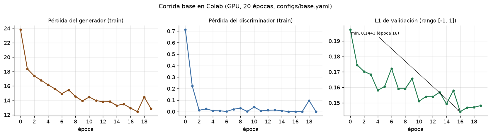
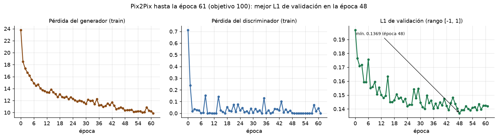
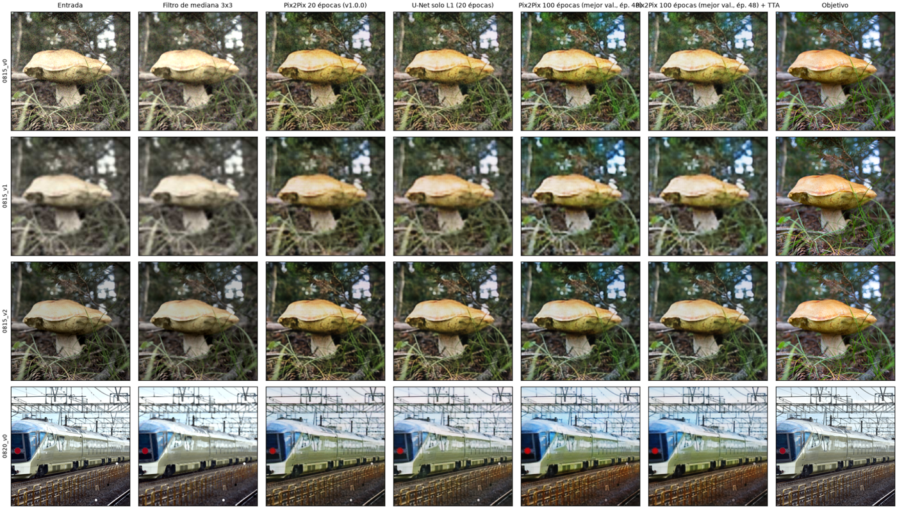

# Restauración de fotografías con Pix2Pix

[](https://github.com/Isabela1105/Trabajo-Final-de-Redes/actions/workflows/ci.yml)

**Curso:** Redes Neuronales y Deep Learning  
**Universidad:** Universidad Autónoma de Occidente  
**Repositorio:** https://github.com/Isabela1105/Trabajo-Final-de-Redes  
**Entrega:** repositorio + informe + sustentación

---

## 1. Contexto

Este proyecto entrena una **GAN condicional (Pix2Pix)** para **restaurar fotografías degradadas**:
ruido, desenfoque, compresión JPEG, rayones, polvo, baja resolución y desvanecido de color.

El dataset es **personalizado**: recolectamos fotos propias o de dominio público y generamos los
pares `(input, target)` con un pipeline de degradaciones reproducible. La foto limpia es el
*ground truth*; la degradada es la entrada del modelo.

**Lo que se entrega:**

- Código comentado y reproducible en TensorFlow/Keras.
- Dataset propio documentado (ficha, manifiesto, splits, ética).
- Modelo entrenado en Colab: checkpoint, `metrics.csv` y muestras en Drive ([evidencias](https://drive.google.com/drive/folders/1abHjMBx08ZmipD9nWkRBtTMhxPD4bYxq) · [carpeta del equipo](https://drive.google.com/drive/folders/1SADEgsZbRjcOhBGSgQsxNNcRtu3O-JIP)).
- Evaluación con PSNR, SSIM y L1 + comparación con baselines.
- Demo web (FastAPI + HTML/CSS/JS) para restaurar una imagen; Gradio como respaldo.
- Informe en PDF y material de sustentación.
- Evidencia de participación de los 6 integrantes (commits, PRs, revisiones).

**Lo que NO se permite:** usar el dataset de caballos/cebras, manzanas/naranjas ni entrenar con
datos descargados sin construir el dataset propio.

---

## 2. Equipo

| Integrante | GitHub | Código | Rol asignado |
|---|---|---|---|
| Isabella Ortiz Hernandez | [@Isabellaortizher-collab](https://github.com/Isabellaortizher-collab) | 2226215 | Datos y dataset |
| Juan Pablo Dávila Moncayo | [@Juanpablodavila](https://github.com/Juanpablodavila) | 2216168 | Generador U-Net |
| Jeremy Santiago Caicedo Cabezas | [@JeremyCaicedo](https://github.com/JeremyCaicedo) | 2210721 | Discriminador y pérdidas |
| Cristian Fabian Muñoz Piedrahita | [@CristianMP355](https://github.com/CristianMP355) | 2230865 | Entrenamiento |
| Juan Sebastian Castillo Acevedo | [@Juansec01](https://github.com/Juansec01) | 2231921 | Evaluación, inferencia y demo |
| Isabela Cabezas Obregón | [@Isabela1105](https://github.com/Isabela1105) | 2226013 | CI/CD, integración e informe |

Quién hizo qué según el historial de GitHub (no según el plan) está en la sección 15 y en
[`docs/PARTICIPACION.md`](docs/PARTICIPACION.md). El generador U-Net, asignado a Juan Pablo,
lo implementó Jeremy (#18).

---

## 3. Arquitectura en una página

```text
Foto degradada (256×256×3, [-1,1])
        │
        ▼
┌─────────────────────────────┐
│ Generador U-Net             │
│ 8 bloques encoder           │
│ 8 bloques decoder + skip    │
│ salida tanh                 │
└─────────────────────────────┘
        │
        ▼
Foto restaurada (256×256×3, [-1,1])

Discriminador PatchGAN:
  concat(input, target) → Conv 64 → 128 → 256 → 512 → 1
  salida: 30×30 logits (cada celda evalúa un parche de 70×70)

Pérdidas:
  L_D = 0.5 · [BCE(D(x,y), 1) + BCE(D(x,G(x)), 0)]
  L_G = BCE(D(x,G(x)), 1) + 100 · L1(G(x), y)
```

| Componente | Contrato |
|---|---|
| Dataset | `(input, target)` float32 `(256,256,3)` en `[-1,1]` |
| Generador | `(B,256,256,3)` → `(B,256,256,3)` en `[-1,1]` |
| Discriminador | `[(B,256,256,3), (B,256,256,3)]` → `(B,30,30,1)` logits |
| Optimizador | Adam, lr 2e-4, β1 0.5 |
| Batch | 2 (`configs/base.yaml`) |
| Épocas | 100 con early stopping por L1 de validación (paciencia 15); la corrida de Colab usó 20 |

Detalle completo: [`docs/MODELOS.md`](docs/MODELOS.md) y
[`docs/ARQUITECTURA.md`](docs/ARQUITECTURA.md).

---

## 4. Resultados

### 4.1 Entrenamiento (corrida base en Colab, 20 épocas)



| Época | L1 val ([-1, 1]) ↓ | PSNR val (dB) ↑ | SSIM val ↑ |
|---|---|---|---|
| 0 | 0.1973 | 18.15 | 0.4340 |
| 16 (mejor L1) | 0.1443 | — | — |
| 19 (última) | 0.1482 | 20.26 | 0.5077 |
| *Entrada sin restaurar* | *0.1680* | *19.27* | *0.4606* |

Fuente: `notebooks/pix2pix_entrenamiento_colab.ipynb` y
[`docs/resultados/colab_base_20ep_log.csv`](docs/resultados/colab_base_20ep_log.csv).
Frente a la foto sin restaurar, el generador gana ≈ 1 dB de PSNR (19.27 → 20.26) y 0.047 de
SSIM en validación; el discriminador gana muy pronto
(pérdida ≈ 0 desde la época 2). Lectura completa en [`docs/RESULTADOS.md`](docs/RESULTADOS.md).

### 4.2 Split de prueba (tabla final)

Generada con `python -m src.gan.evaluate` + `python scripts/results_table.py`; no se escribe
a mano. Líneas base y protocolo: [`docs/ARQUITECTURA.md` §6](docs/ARQUITECTURA.md).

<!-- RESULTADOS:INICIO -->
| Modelo | n | PSNR (dB) ↑ | SSIM ↑ | L1 ↓ |
|---|---|---|---|---|
| Entrada (sin restaurar) | 45 | 20.30 ± 2.68 | 0.6558 ± 0.1789 | 0.0749 ± 0.0279 |
| Filtro de mediana 3x3 | 45 | 20.05 ± 2.26 | 0.6655 ± 0.1076 | 0.0755 ± 0.0264 |
| Pix2Pix 20 épocas (v1.0.0) | 45 | 20.67 ± 2.15 | 0.6835 ± 0.1094 | 0.0732 ± 0.0263 |
| U-Net solo L1 (20 épocas) | 45 | 20.87 ± 1.98 | 0.7011 ± 0.1102 | 0.0704 ± 0.0215 |
| U-Net solo L1 (mejor val., ép. 45) + TTA | 45 | 21.21 ± 2.22 | 0.7222 ± 0.1100 | 0.0694 ± 0.0249 |
| Pix2Pix 100 épocas (mejor val., ép. 48) | 45 | 21.14 ± 2.08 | 0.7003 ± 0.1064 | 0.0690 ± 0.0220 |
| **Pix2Pix 100 épocas (mejor val., ép. 48) + TTA** | 45 | 21.30 ± 2.15 | 0.7165 ± 0.1077 | 0.0681 ± 0.0236 |

_Split `test`, métricas en [0, 1] por imagen completa (media ± std). Fuente: `docs/resultados/test_100ep/summary.csv`._
<!-- RESULTADOS:FIN -->

**Modelo vigente:** Pix2Pix con objetivo de 100 épocas, **elegido por la mejor L1 de validación
(época 48)** y con **TTA** (promedio de la foto y sus 3 versiones volteadas). En una GAN la última
época no es la mejor: una corrida completa de 100 en Colab terminó en 20.41 dB, por debajo del
modelo de 20 épocas. Con la selección por validación:

- Frente a la foto dañada: **+1.00 dB y +0.061 de SSIM** (la entrega anterior daba +0.37 y +0.028).
- Frente a la entrega `v1.0.0`: +0.63 dB (t = 4.75 pareado), mejor SSIM en **las 45 fotos**.
- Frente a la U-Net solo L1 **con el mismo protocolo** (100 épocas, selección por validación y TTA):
  empate en PSNR y L1 (+0.09 dB, t = 1.3) y la U-Net gana en SSIM (+0.006, t = 6.1). La GAN no
  mejora las métricas píxel a píxel; lo esperado según Isola et al. (2017).

**Análisis de errores:** mejora todos los tipos de daño, sobre todo rayones, contraste y color
(+2.0 a +2.8 dB), y menos JPEG, polvo y baja resolución. El modo de falla: **sobre-corrige fotos
poco dañadas** (entrada ≥ 22 dB: −2.5 dB en 10 de 11) porque nunca vio pares sin daño. Se probaron
y descartaron, por no mejorar la validación: pares sin daño, mezcla salida/entrada y
ampliar el entrenamiento a 1 220 pares (§7). Todo en
[`docs/RESULTADOS.md` §6](docs/RESULTADOS.md#6-nueva-sustentación-100-épocas-selección-por-validación-y-tta).





Peores casos (sin elegir a mano): [`docs/img/failures_100ep.png`](docs/img/failures_100ep.png)

---

## 5. Demo

Demo principal: página propia servida por FastAPI, sin internet.

**Pesos entrenados:** descargar `pix2pix_20ep.zip` (y opcionalmente `ablacion_solo_l1_20ep.zip`)
del [release `v1.0.0`](https://github.com/Isabela1105/Trabajo-Final-de-Redes/releases/tag/v1.0.0)
y descomprimirlo en la raíz del repositorio: queda `outputs/base/checkpoints/` (y
`outputs/ablation/checkpoints/`), que es lo que usan los comandos de abajo.

```bash
python -m app.server --checkpoint outputs/base/checkpoints
# abrir http://127.0.0.1:8000
```

**Modelo vigente (100 épocas, época 48):** descargar [`pix2pix_100ep_mejor.zip`](https://github.com/Isabela1105/Trabajo-Final-de-Redes/releases/download/v1.1.0/pix2pix_100ep_mejor.zip) (release `v1.1.0`), descomprimirlo en
la raíz (queda `outputs/pix2pix_100ep_mejor/best/`) y usar
`python -m app.server --checkpoint outputs/pix2pix_100ep_mejor/best`. La demo aplica por defecto
limpieza de polvo y TTA; la casilla *Realzar nitidez* es opcional (más definida a la vista, baja
un poco el PSNR).

Respaldo con Gradio: `python -m app.gradio_app --checkpoint outputs/base/checkpoints`.
API, Colab y plan A/B/C: [`docs/DEMO.md`](docs/DEMO.md).

---

## 6. Inicio rápido

### 6.1 Clonar e instalar

```bash
git clone https://github.com/Isabela1105/Trabajo-Final-de-Redes.git
cd Trabajo-Final-de-Redes
python -m venv .venv
```

Windows:

```powershell
.venv\Scripts\activate
```

Linux/Mac:

```bash
source .venv/bin/activate
```

```bash
python -m pip install --upgrade pip
pip install -r requirements-dev.txt
pre-commit install
```

### 6.2 Smoke test (CPU, segundos)

```bash
python scripts/make_synthetic_sample.py --out data/sample --n 8 --size 64
python -m src.gan.train --config configs/smoke.yaml --max-steps 2
pytest -q
```

Si esto funciona, el pipeline está sano. El entrenamiento real va en Colab/Kaggle.

---

## 7. Dataset

**Descarga:** [`datasetv1.zip`](https://drive.google.com/file/d/1EqFt7d8VX88XKm5Vj_vA7QO1BAx60JtZ/view?usp=sharing) y el resto del material en la [carpeta de Drive del equipo](https://drive.google.com/drive/folders/1SADEgsZbRjcOhBGSgQsxNNcRtu3O-JIP), compartida solo con
los integrantes y el docente: contiene `datasetv1.zip` (456 pares PNG 256×256 en
`processed/{train,val,test}/{input,target}`), `real.zip` (12 fotos antiguas para inspección
visual), el PDF *Avance del trabajo de datos y dataset* y la carpeta `checkpoints/`. No es pública
porque las fotos de DIV2K (solo uso académico) y las de Pinterest no se pueden redistribuir.
En el repositorio quedan la ficha, el manifiesto con la semilla de cada par
(`data/manifest.csv`) y las fuentes (`data/sources.csv`), con lo que el dataset se reconstruye
idéntico a partir de las fotos originales. Evidencias de entrenamiento: [Drive](https://drive.google.com/drive/folders/1abHjMBx08ZmipD9nWkRBtTMhxPD4bYxq).

Para usarlo: descomprimir `datasetv1.zip` dentro de `data/` (queda `data/processed/`), o
abrir `notebooks/pix2pix_colab.ipynb`, que lo busca en Drive y lo extrae solo.

Para reconstruirlo desde las fotos originales:

```bash
# 1. Colocar fotos originales en data/raw/
# 2. Generar pares y splits por fuente
python scripts/build_dataset.py --raw data/raw --out data/processed --variants 3 --seed 42

# 3. Validar estructura y fuga de datos
python scripts/check_dataset.py --root data/processed --manifest data/manifest.csv
```

- Splits: **80 % train / 10 % val / 10 % test**, por foto fuente (no por parche).
- 2–3 variantes de degradación por foto.
- Manifiesto con semilla y parámetros.
- Ficha completa: [`docs/DATASET.md`](docs/DATASET.md) y [`data/README.md`](data/README.md).

---

## 8. Entrenamiento

```bash
# Entrenamiento principal
python -m src.gan.train --config configs/base.yaml

# Reanudar tras una desconexión de Colab (último checkpoint de outputs/base/checkpoints)
python -m src.gan.train --config configs/base.yaml --resume

# Ablación: U-Net solo L1 (use_gan: false, λ = 1000)
python -m src.gan.train --config configs/ablation_l1.yaml
```

Salidas:

```text
outputs/base/
├── checkpoints/     # ckpt-N (G, D y optimizadores) + config.yaml + metadata.json
├── samples/         # grids cada N épocas
├── logs/            # TensorBoard
└── metrics.csv      # pérdidas y métricas
```

Notebooks de Colab: [`notebooks/`](notebooks/README.md). Hardware recomendado: Colab T4 o Kaggle P100. En Windows, TensorFlow ≥ 2.11 no tiene GPU nativa;
usar WSL2, Colab o Kaggle.

---

## 9. Evaluación e inferencia

```bash
# Evaluar el test set: Entrada, Mediana 3x3 y Pix2Pix (+ ablación si se pasa)
python -m src.gan.evaluate --config configs/base.yaml \
  --checkpoint outputs/base/checkpoints \
  --model "U-Net solo L1=outputs/ablation/checkpoints"

# Insertar la tabla en README e informe
python scripts/results_table.py --summary outputs/base/eval/summary.csv \
  --update README.md report/informe.md docs/RESULTADOS.md

# Restaurar una imagen (quita también los puntos de polvo; --sin-limpieza para desactivarlo)
python -m src.gan.infer --checkpoint outputs/base/checkpoints \
  --input ruta/a/foto.jpg --output ruta/a/restaurada.png
```

Por defecto aplica limpieza de polvo y TTA (`--sin-limpieza`, `--sin-tta` para desactivarlos) y
acepta `--nitidez 0.5` para realzar bordes. La limpieza sube el PSNR de las fotos con polvo del
modelo de 20 épocas de 20.52 a 20.82 dB. Detalle en `docs/RESULTADOS.md` §2.5.

Métricas: PSNR, SSIM y L1 en `[0, 1]` por imagen, media ± desviación estándar. FID opcional
con `--fid`. Atajos: `make eval`, `make results`, `make demo`.

---

## 10. Estructura del repositorio

```text
.
├── .github/
│   ├── workflows/ci.yml          # lint + tests + muestra sintética + smoke training
│   ├── workflows/release.yml     # informe + release en tags v*
│   ├── PULL_REQUEST_TEMPLATE.md
│   ├── ISSUE_TEMPLATE/tarea.md
│   └── CODEOWNERS
├── app/
│   ├── server.py                 # demo principal (FastAPI)
│   └── gradio_app.py             # demo de respaldo
├── web/                          # index.html, styles.css, app.js de la demo
├── configs/
│   ├── base.yaml                 # entrenamiento real (hiperparámetros congelados)
│   ├── smoke.yaml                # CI / CPU
│   └── ablation_l1.yaml          # U-Net solo L1
├── data/                         # README, manifest.csv y fuentes (las imágenes no se versionan)
├── docs/
│   ├── ARQUITECTURA.md · DATASET.md · MODELOS.md · DECISIONES.md
│   ├── RESULTADOS.md · DEMO.md · DEFENSA.md · INFORME.md
│   ├── PARTICIPACION.md · EQUIPO.md · PLAN_COMMITS.md · CI_CD.md
│   ├── resultados/               # registros de entrenamiento transcritos
│   └── img/                      # figuras del README y del informe
├── guias/                        # guía individual por integrante
├── notebooks/                    # Colab: entrenamiento, ablación, evaluación y demo
├── report/
│   ├── Informe_Pix2Pix.docx      # informe final oficial (Word) y su PDF
│   ├── Trabajo_Final_Redes.docx  # versión de trabajo del informe y su PDF
│   ├── informe.md · informe.pdf  # informe técnico del repositorio
│   └── referencias.bib
├── scripts/
│   ├── build_dataset.py · check_dataset.py · dataset_report.py · prepare_real.py
│   ├── make_synthetic_sample.py  # datos falsos para CI
│   ├── results_table.py          # tabla de resultados desde summary.csv
│   └── plot_training_log.py      # curvas de entrenamiento
├── src/gan/
│   ├── config.py · losses.py · train.py
│   ├── metrics.py · evaluate.py · infer.py
│   ├── despeckle.py              # limpieza de puntos de polvo
│   ├── data/                     # dataset, degradaciones, estadísticas, tf.data
│   ├── models/                   # blocks.py, generator.py, discriminator.py
│   └── utils/viz.py
├── tests/
├── CONTRIBUTING.md · GUIA.md · LICENSE · Makefile
├── pyproject.toml
├── requirements.txt
└── requirements-dev.txt
```

---

## 11. Flujo de trabajo con 6 personas

### 11.1 Reglas de oro

1. **Nadie hace push directo a `main`.** Todo entra por Pull Request.
2. **Un issue = una rama = un PR.** PRs de máximo ~400 líneas.
3. **El autor no mergea su propio PR.** Mínimo 1 aprobación; 2 en rutas críticas.
4. **CI verde obligatorio.**
5. **Primer commit en los primeros 2 días.**
6. **Cada semana:** 1 PR propio + 1 revisión + 1 aporte al informe/docs.
7. **Todo el código vive en el repo.** Nada de código solo en WhatsApp/Drive.
8. **Pair programming se acredita** con `Co-authored-by:`.
9. **No se reescribe la historia de `main`.**
10. **Después del día 24 no se agregan features.**

### 11.2 Ramas por integrante

Plan original completo en [`docs/PLAN_COMMITS.md`](docs/PLAN_COMMITS.md). Ramas que existen o
existieron de verdad:

| Integrante | Ramas reales |
|---|---|
| Isabella Ortiz (@Isabellaortizher-collab) | PRs #10, #11, #12, #15, #16, #17 (squash merge, ramas borradas) |
| Juan Pablo (@Juanpablodavila) | ninguna todavía |
| Jeremy (@JeremyCaicedo) | `feat/generator-unet`, `feat/discriminator-losses`, `Jeremycaicedo-patch-1` (#18, #21, #22) |
| Cristian (@CristianMP355) | PRs #25–#29 (squash merge) |
| Juan Sebastian (@Juansec01) | PRs #30–#36: `feat/16-metrics-inference`, `docs/17-baselines`, `feat/26-eval-app`, `feat/33-results-app`, `fix/37-app-formats`, `test/41-synthetic-sample`, `docs/43-cierre-participacion` |
| Isabela (@Isabela1105) | PR #14 |

### 11.3 Commits

Formato **Conventional Commits**:

```text
tipo(area): descripción en imperativo (#issue)
```

Ejemplos:

```text
feat(data): implementar emparejamiento y split por fuente (#7)
feat(model): implementar generador U-Net configurable (#10)
feat(loss): implementar pérdidas adversarial y L1 (#12)
feat(train): integrar dataset y modelo en el bucle (#23)
feat(eval): implementar PSNR, SSIM y L1 (#16)
ci: agregar workflow de lint, tests y smoke training (#2)
```

### 11.4 Pull Requests

- Título con el mismo formato del commit.
- Descripción con la plantilla de `.github/PULL_REQUEST_TEMPLATE.md`.
- `Closes #<issue>`.
- Revisor asignado distinto del autor.
- Captura/métrica si cambia la salida visual.
- Squash merge; borrar la rama.

### 11.5 Orden de merge

| Semana | PRs | Objetivo |
|---|---|---|
| 1 | F1, A1, B1, C1, D1, E1, F2, F3, A2, B2, C2, D2, E2, A3, B3, C3, D3, E3 | Fundaciones: repo, CI, contratos, dataset v1, modelos, train skeleton, métricas |
| 2 | A4, B4, C4, D4, E4, F4 | Integración: primer entrenamiento, evaluación, demo mínima, quality gates |
| 3 | A5, B5, C5, D5, E5, F5 | Experimentos: entrenamiento completo, ablación, resultados, app, borrador del informe |
| 4 | A6, B6, C6, D6, E6, F6 | Cierre: correcciones, informe final, release `v1.0.0`, ensayo de defensa |

Detalle exacto de commits, PRs y revisores:
[`docs/PLAN_COMMITS.md`](docs/PLAN_COMMITS.md).

---

## 12. CI/CD

Cada PR ejecuta:

1. `ruff check .`
2. `black --check .`
3. `pytest -q --cov=src`
4. Generación de 8 imágenes sintéticas de 64×64.
5. Smoke training de 2 pasos en CPU.
6. Validación del título del PR.

`main` está protegida: PR obligatorio, 1 aprobación, checks verdes, historial lineal.

Al crear un tag `v*`, el workflow de release construye el informe en DOCX/PDF y publica un
GitHub Release.

Configuración y solución de problemas: [`docs/CI_CD.md`](docs/CI_CD.md).

---

## 13. Documentación

| Documento | Contenido |
|---|---|
| [`GUIA.md`](GUIA.md) | Guía maestra: requisitos, decisiones, riesgos, checklist. |
| [`docs/MODELOS.md`](docs/MODELOS.md) | Comparación de arquitecturas y justificación de Pix2Pix. |
| [`docs/ARQUITECTURA.md`](docs/ARQUITECTURA.md) | Diagramas, tablas de capas, contratos, pérdidas. |
| [`docs/DATASET.md`](docs/DATASET.md) | Recolección, degradaciones, splits, ética. |
| [`docs/PLAN_COMMITS.md`](docs/PLAN_COMMITS.md) | Plan de commits por rol. |
| [`docs/CI_CD.md`](docs/CI_CD.md) | GitHub Actions, branch protection, release. |
| [`docs/INFORME.md`](docs/INFORME.md) | Estructura del informe y responsables. |
| [`docs/DEFENSA.md`](docs/DEFENSA.md) | Guion y banco de preguntas. |
| [`docs/EXPLICACION_CODIGO.md`](docs/EXPLICACION_CODIGO.md) | Recorrido archivo → función → para qué sirve. |
| [`docs/PARTICIPACION.md`](docs/PARTICIPACION.md) | Evidencia de participación (desde el historial real). |
| [`docs/RESULTADOS.md`](docs/RESULTADOS.md) | Curvas, validación, tabla del test y ablación. |
| [`docs/DEMO.md`](docs/DEMO.md) | Ejecutar y desplegar la demo. |
| [`docs/EXPERIMENTO_NITIDEZ.md`](docs/EXPERIMENTO_NITIDEZ.md) | Experimento posterior: pérdida perceptual VGG16 para recuperar nitidez. |
| [`docs/GUIA_PRUEBAS.md`](docs/GUIA_PRUEBAS.md) | Cómo probar todo: tests, pipeline falso, modelo real y casos difíciles. |
| [`docs/REFERENCIA_CODIGO.md`](docs/REFERENCIA_CODIGO.md) | Código comentado de referencia. |
| [`docs/MERGE_Y_REVISION.md`](docs/MERGE_Y_REVISION.md) | Cómo integrar y revisar todo al final. |

### Guías individuales

| Integrante | Rol | Guía |
|---|---|---|
| Isabella Ortiz | Datos y dataset | [`guias/GUIA-Isabellaortizher-collab.md`](guias/GUIA-Isabellaortizher-collab.md) |
| Juan Pablo Dávila | Generador U-Net | [`guias/GUIA-Juanpablodavila.md`](guias/GUIA-Juanpablodavila.md) |
| Jeremy Caicedo | Discriminador y pérdidas | [`guias/GUIA-JeremyCaicedo.md`](guias/GUIA-JeremyCaicedo.md) |
| Cristian Muñoz | Entrenamiento | [`guias/GUIA-CristianMP355.md`](guias/GUIA-CristianMP355.md) |
| Juan Sebastian Castillo | Evaluación y demo | [`guias/GUIA-Juansec01.md`](guias/GUIA-Juansec01.md) |
| Isabela Cabezas | CI/CD, integración e informe | [`guias/GUIA-Isabela1105.md`](guias/GUIA-Isabela1105.md) |

Índice y orden de lectura: [`guias/README.md`](guias/README.md).

---

## 14. Informe y sustentación

- **Informe final (oficial):** [`report/Informe_Pix2Pix.pdf`](report/Informe_Pix2Pix.pdf) · [Word](report/Informe_Pix2Pix.docx).
- Versión de trabajo del informe: [`report/Trabajo_Final_Redes.docx`](report/Trabajo_Final_Redes.docx) · [PDF](report/Trabajo_Final_Redes.pdf); informe técnico en Markdown: [`report/informe.md`](report/informe.md).
  Versión pública: sin las 12 fotos antiguas reales, que tienen licencia sin verificar.
- Informe técnico del repositorio: [`report/informe.md`](report/informe.md) → [`report/informe.pdf`](report/informe.pdf).
- Estructura y responsables: [`docs/INFORME.md`](docs/INFORME.md).
- Guion de defensa y 24 preguntas: [`docs/DEFENSA.md`](docs/DEFENSA.md).

**Regla:** el docente elige al azar a un integrante. Todos deben poder explicar la arquitectura,
las pérdidas, el dataset, el entrenamiento, las métricas y una línea de código cualquiera.

---

## 15. Participación

Resumen del historial de `main` (detalle, enlaces y pendientes en
[`docs/PARTICIPACION.md`](docs/PARTICIPACION.md)):

| Integrante | PRs en `main` | Aporte verificable | Informe / defensa |
|---|---|---|---|
| Isabella Ortiz | 6 (#10–#12, #15–#17) | Dataset completo y cargador `tf.data` | Dataset |
| Juan Pablo Dávila | 0 | Sin commits a la fecha | Generador (asignado) |
| Jeremy Caicedo | 2 (#18, #21) + 1 commit directo | Generador U-Net, PatchGAN y pérdidas | Marco teórico, arquitectura |
| Cristian Muñoz | 5 (#25–#29) | Entrenamiento, checkpoints, ablación | Entrenamiento |
| Juan Sebastian Castillo | andamiaje inicial + 7 PRs de cierre (#30–#36) | Repo base, evaluación, inferencia, demo, CI smoke, docs de cierre | Resultados, demo |
| Isabela Cabezas | 1 (#14) | `.gitattributes`; dueña del repo y del release | Intro, conclusiones |

```bash
git shortlog -sne origin/main
```

---

## 16. Checklist de entrega

- [x] Repo público con los 6 integrantes como collaborators.
- [x] CI con lint, tests y smoke training (con muestra sintética).
- [x] Dataset construido y documentado (456 pares, split 80/10/10 por fuente).
- [x] Generador, discriminador, pérdidas y train loop implementados.
- [x] Entrenamiento real en Colab con checkpoint en Drive (20 épocas).
- [x] Métricas PSNR/SSIM/L1 + baselines implementadas y probadas.
- [x] Demo web (FastAPI) + respaldo Gradio.
- [x] Tabla del test generada con líneas base, Pix2Pix y ablación (`docs/RESULTADOS.md`).
- [x] Ablación sin GAN entrenada y evaluada.
- [x] Informe final oficial en Word y PDF (`report/Informe_Pix2Pix.*`), versión de trabajo (`report/Trabajo_Final_Redes.*`) e informe técnico (`report/informe.*`).
- [x] Releases con pesos: `v1.0.0` (entrega anterior, 20 épocas) y `v1.1.0` (modelo vigente, `pix2pix_100ep_mejor.zip`).
- [ ] Dos ensayos de defensa con presentador aleatorio.

---

## 17. Licencia

Código: MIT (ver [`LICENSE`](LICENSE)).
Dataset: ver [`data/README.md`](data/README.md). Las fotos de terceros conservan su licencia.
