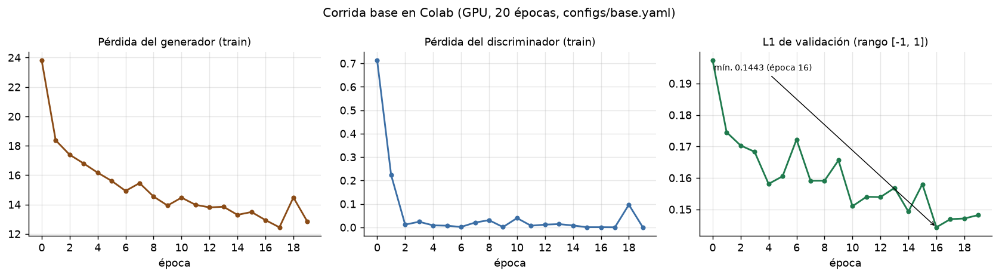

# Resultados

Responsable: Juan Sebastian Castillo Acevedo (`@Juansec01`). Bucle de entrenamiento de Cristian
Muñoz (`@CristianMP355`); la corrida base en Colab la ejecutó Isabela Cabezas (`@Isabela1105`) y
sus artefactos están en su Drive (`pix2pix_outputs/metricas_loss_existente/`).

Regla: cada cifra de este documento sale de un archivo. Si un número no tiene archivo
detrás, no se publica.

## 1. Corrida base en Colab (evidencia disponible)

| Dato | Valor | Fuente |
|---|---|---|
| Configuración | `configs/base.yaml` con `epochs: 20` y rutas de Colab | `notebooks/pix2pix_entrenamiento_colab.ipynb` (celda 5) |
| Hardware | Colab con GPU, TensorFlow 2.21.0, mixed precision activa | mismo notebook (celdas 1 y 7) |
| Dataset | 366 / 45 / 45 pares (train / val / test), 256×256 | `docs/dataset_stats.md` y celda 7 del notebook |
| Pérdidas | `src/gan/losses.py` de la rama `feat/discriminator-losses` (BCE + λ·L1, λ = 100); solo difiere de `main` en un `if` equivalente | celdas 2 y 6 del notebook |
| Duración | 522.1 s para 20 épocas | salida de la celda de entrenamiento |
| Registro por época | `docs/resultados/colab_base_20ep_log.csv` | transcrito de la salida impresa por `train.py` |



`python scripts/plot_training_log.py docs/resultados/colab_base_20ep_log.csv docs/img/curvas_entrenamiento.png`

### 1.1 Validación (`metrics.csv` de la corrida, split `val`)

| Época | L1 val ([-1, 1]) ↓ | PSNR val (dB) ↑ | SSIM val ↑ |
|---|---|---|---|
| 0 | 0.1973 | 18.15 | 0.4340 |
| 1 | 0.1745 | 19.19 | 0.4764 |
| 2 | 0.1703 | 19.40 | 0.4841 |
| 3 | 0.1683 | 19.46 | 0.4833 |
| 4 | 0.1581 | 19.71 | 0.4974 |
| 16 (mejor L1) | 0.1443 | — | — |
| 19 (última) | 0.1482 | 20.26 | 0.5077 |
| *Referencia: entrada sin restaurar* | *0.1680* | *19.27* | *0.4606* |

Las filas 0–4 y 19 son las que el notebook mostró completas; para las épocas 5–18 solo quedó
impresa la L1 de validación (ver el CSV transcrito). El `metrics.csv` completo está en el Drive
del equipo (`pix2pix_outputs/metricas_loss_existente/metrics.csv`).

> **Cuidado al comparar.** `train.py` mide en `[-1, 1]`. Su PSNR es igual al de `[0, 1]`, pero
> su L1 es el **doble**: 0.1482 en `[-1, 1]` equivale a ≈ 0.074 en `[0, 1]`. La tabla final del
> test usa `[0, 1]` (`src/gan/metrics.py`).

### 1.2 Lectura de las curvas

- **El generador sí aprende y supera a no hacer nada:** frente a la foto degradada sin
  restaurar (misma convención de `train.py`, `docs/resultados/val_lineas_base_summary.csv`),
  la época 19 mejora +0.99 dB de PSNR (19.27 → 20.26), +0.047 de SSIM (0.461 → 0.508) y −12 % de
  L1 (0.168 → 0.148). En la época 0 el modelo estaba **por debajo** de la entrada (18.15 dB): las
  primeras épocas solo aprenden a no empeorar la foto.
- **La mejora es modesta:** ≈ 1 dB sobre la entrada. Con 20 épocas y D dominando, el margen
  es pequeño; la corrida de 45 épocas de Cristian (sección 3) llega a 20.61 dB.
- **El discriminador domina pronto:** desde la época 2 su pérdida queda por debajo de 0.04 y
  termina en ≈ 0. Significa que distingue casi perfectamente lo real de lo generado; el
  generador avanza sobre todo por el término L1. Es una limitación conocida de Pix2Pix con
  datasets pequeños y la razón de dejar documentadas opciones como *label smoothing*.
- **No hubo early stopping:** la mejor L1 fue en la época 16 y la paciencia es 15 épocas; con
  solo 20 épocas la corrida terminó por límite. El checkpoint guardado es el de la última época
  (19), cuya L1 está a 0.004 de la mejor.

## 2. Tabla final del split de prueba

La tabla se genera con `src/gan/evaluate.py` sobre los 45 pares de `test` y se inserta en el
README y en el informe con `scripts/results_table.py`. No se escribe a mano.

```bash
# Con la carpeta checkpoints/ de la corrida copiada en outputs/base/checkpoints
python -m src.gan.evaluate --config configs/base.yaml --checkpoint outputs/base/checkpoints
python scripts/results_table.py --summary outputs/base/eval/summary.csv \
  --update README.md report/informe.md docs/RESULTADOS.md
cp outputs/base/eval/results_grid.png outputs/base/eval/failures.png docs/img/
```

La sección 5 de `notebooks/pix2pix_colab.ipynb` hace estos pasos en Colab leyendo el
checkpoint desde Drive.

<!-- RESULTADOS:INICIO -->
| Modelo | n | PSNR (dB) ↑ | SSIM ↑ | L1 ↓ |
|---|---|---|---|---|
| Entrada (sin restaurar) | 45 | 20.30 ± 2.68 | 0.6558 ± 0.1789 | 0.0749 ± 0.0279 |
| Filtro de mediana 3x3 | 45 | 20.05 ± 2.26 | 0.6655 ± 0.1076 | 0.0755 ± 0.0264 |

_Split `test`, métricas en [0, 1] por imagen completa (media ± std). Fuente: `docs/resultados/test_lineas_base_summary.csv`._

_Filas de Pix2Pix y U-Net solo L1: pendientes del checkpoint de la corrida de Cristian (`Redes-Pix2Pix/checkpoints/`)._
<!-- RESULTADOS:FIN -->

## 3. Corrida de 45 épocas y ablación (Cristian Muñoz)

Cristian entrenó en Colab (GPU T4, último `main`, `datasetv1.zip`) la base Pix2Pix y la ablación
sin GAN. Cifras **reportadas por él**, pendientes de sumar sus `metrics.csv` al repositorio:

| Corrida | Épocas | PSNR val (dB) | SSIM val |
|---|---|---|---|
| Entrada sin restaurar (referencia) | — | 19.27 | 0.4606 |
| Pix2Pix (GAN + L1, λ = 100) | 45 | 20.61 | 0.5164 |
| U-Net solo L1 (λ = 1000, sin D) | 44 | 20.78 | 0.5397 |

La ablación supera a Pix2Pix en PSNR y SSIM. Es esperable: ambas métricas premian la
fidelidad píxel a píxel, que es justo lo que optimiza L1, mientras el término adversarial
empuja a texturas plausibles que pueden alejarse del píxel exacto. La comparación visual
(`results_grid.png`) es la que muestra si la GAN aporta nitidez.

### 3.1 Implementación de la ablación

`configs/ablation_l1.yaml` + `train.use_gan: false` + `λ = 1000` ya está implementado y probado
(`tests/test_train_integration.py::test_real_ablation_only_trains_generator`). Un primer
intento con el notebook original falló porque el zip del dataset no estaba en la ruta esperada;
la corrida de Cristian de la tabla anterior sí se completó. Para repetirla:
`notebooks/pix2pix_colab.ipynb`, sección 3 (`ENTRENAR_ABLACION = True`).

## 4. Qué queda por correr

| Paso | Comando o notebook | Resultado |
|---|---|---|
| Evaluar el test | `notebooks/pix2pix_colab.ipynb` (sección 5) | `summary.csv`, tabla, `results_grid.png`, `failures.png` |
| Subir los pesos de Cristian | `Redes-Pix2Pix/checkpoints/{base,ablation}/` | filas Pix2Pix y U-Net solo L1 de la tabla |
| Captura de la demo | `python -m app.server --checkpoint …` | `docs/img/app.png` |
