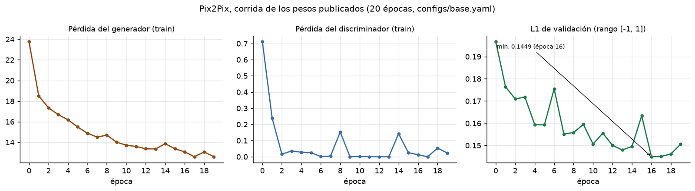
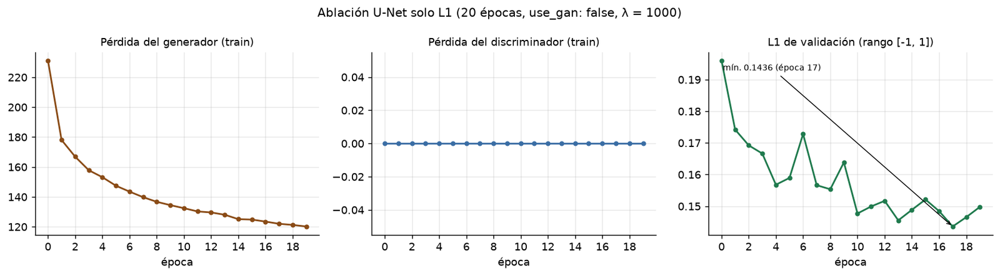
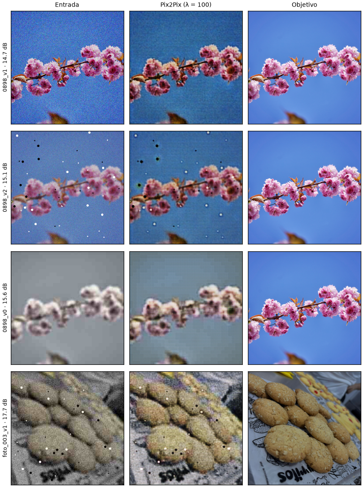

# Resultados

Responsable: Juan Sebastian Castillo Acevedo (`@Juansec01`). Bucle de entrenamiento de Cristian
Muñoz (`@CristianMP355`); la corrida base en Colab la ejecutó Isabela Cabezas (`@Isabela1105`) y
sus artefactos están en su Drive (`pix2pix_outputs/metricas_loss_existente/`).

Regla: cada cifra de este documento sale de un archivo. Si un número no tiene archivo
detrás, no se publica.

> **Modelo vigente (nueva sustentación):** Pix2Pix entrenado hasta 100 épocas y elegido por
> validación (época 62). Ver la [sección 6](#6-nueva-sustentación-100-épocas-y-selección-por-validación).
> Las secciones 1 a 5 documentan la entrega `v1.0.0` (20 épocas) y no se reescriben.

## 1. Corrida base en Colab (evidencia disponible)

| Dato | Valor | Fuente |
|---|---|---|
| Configuración | `configs/base.yaml` con `epochs: 20` y rutas de Colab | `notebooks/pix2pix_entrenamiento_colab.ipynb` (celda 5) |
| Hardware | Colab con GPU, TensorFlow 2.21.0, mixed precision activa | mismo notebook (celdas 1 y 7) |
| Dataset | 366 / 45 / 45 pares (train / val / test), 256×256 | `docs/dataset_stats.md` y celda 7 del notebook |
| Pérdidas | `src/gan/losses.py` de la rama `feat/discriminator-losses` (BCE + λ·L1, λ = 100); solo difiere de `main` en un `if` equivalente | celdas 2 y 6 del notebook |
| Duración | 522.1 s para 20 épocas | salida de la celda de entrenamiento |
| Registro por época | `docs/resultados/colab_base_20ep_log.csv` | transcrito de la salida impresa por `train.py` |


`python scripts/plot_training_log.py docs/resultados/colab_base_20ep_log.csv docs/img/curvas_entrenamiento.png`

### 1.1 Validación (`metrics.csv` de la corrida, split `val`)

| Época | L1 val ([-1, 1]) ↓ | PSNR val (dB) ↑ | SSIM val ↑ |
|---|---|---|---|
| 0 | 0.1973 | 18.15 | 0.4340 |
| 1 | 0.1745 | 19.19 | 0.4764 |
| 2 | 0.1703 | 19.40 | 0.4841 |
| 3 | 0.1683 | 19.46 | 0.4833 |
| 4 | 0.1581 | 19.71 | 0.4974 |
| 16 (mejor L1) | 0.1443 | — | — |
| 19 (última) | 0.1482 | 20.26 | 0.5077 |
| *Referencia: entrada sin restaurar* | *0.1680* | *19.27* | *0.4606* |

Las filas 0–4 y 19 son las que el notebook mostró completas; para las épocas 5–18 solo quedó
impresa la L1 de validación (ver el CSV transcrito). El `metrics.csv` completo está en el Drive
del equipo (`pix2pix_outputs/metricas_loss_existente/metrics.csv`).

> **Cuidado al comparar.** `train.py` mide en `[-1, 1]`. Su PSNR es igual al de `[0, 1]`, pero
> su L1 es el **doble**: 0.1482 en `[-1, 1]` equivale a ≈ 0.074 en `[0, 1]`. La tabla final del
> test usa `[0, 1]` (`src/gan/metrics.py`).

### 1.2 Lectura de las curvas

- **El generador sí aprende y supera a no hacer nada:** frente a la foto degradada sin
  restaurar (misma convención de `train.py`, `docs/resultados/val_lineas_base_summary.csv`),
  la época 19 mejora +0.99 dB de PSNR (19.27 → 20.26), +0.047 de SSIM (0.461 → 0.508) y −12 % de
  L1 (0.168 → 0.148). En la época 0 el modelo estaba **por debajo** de la entrada (18.15 dB): las
  primeras épocas solo aprenden a no empeorar la foto.
- **La mejora es modesta:** ≈ 1 dB sobre la entrada. Con 20 épocas y D dominando, el margen
  es pequeño; la corrida de 45 épocas de Cristian (sección 3) llega a 20.61 dB.
- **El discriminador domina pronto:** desde la época 2 su pérdida queda por debajo de 0.04 y
  termina en ≈ 0. Significa que distingue casi perfectamente lo real de lo generado; el
  generador avanza sobre todo por el término L1. Es una limitación conocida de Pix2Pix con
  datasets pequeños y la razón de dejar documentadas opciones como *label smoothing*.
- **No hubo early stopping:** la mejor L1 fue en la época 16 y la paciencia es 15 épocas; con
  solo 20 épocas la corrida terminó por límite. El checkpoint guardado es el de la última época
  (19), cuya L1 está a 0.004 de la mejor.

## 2. Tabla final del split de prueba

La tabla se genera con `src/gan/evaluate.py` sobre los 45 pares de `test` y se inserta en el
README y en el informe con `scripts/results_table.py`. No se escribe a mano.

```bash
# Con la carpeta checkpoints/ de la corrida copiada en outputs/base/checkpoints
python -m src.gan.evaluate --config configs/base.yaml --checkpoint outputs/base/checkpoints
python scripts/results_table.py --summary outputs/base/eval/summary.csv \
  --update README.md report/informe.md docs/RESULTADOS.md
cp outputs/base/eval/results_grid.png outputs/base/eval/failures.png docs/img/
```

La sección 5 de `notebooks/pix2pix_colab.ipynb` hace estos pasos en Colab leyendo el
checkpoint desde Drive.

<!-- RESULTADOS:INICIO -->
| Modelo | n | PSNR (dB) ↑ | SSIM ↑ | L1 ↓ |
|---|---|---|---|---|
| Entrada (sin restaurar) | 45 | 20.30 ± 2.68 | 0.6558 ± 0.1789 | 0.0749 ± 0.0279 |
| Filtro de mediana 3x3 | 45 | 20.05 ± 2.26 | 0.6655 ± 0.1076 | 0.0755 ± 0.0264 |
| **U-Net solo L1** | 45 | 20.87 ± 1.98 | 0.7011 ± 0.1102 | 0.0704 ± 0.0215 |
| Pix2Pix (λ = 100) | 45 | 20.67 ± 2.15 | 0.6835 ± 0.1094 | 0.0732 ± 0.0263 |

_Split `test`, métricas en [0, 1] por imagen completa (media ± std). Fuente: `docs/resultados/test/summary.csv`._
<!-- RESULTADOS:FIN -->

### 2.1 Qué pesos se evaluaron

Los checkpoints de las corridas de Colab no quedaron accesibles, así que la tabla usa una corrida
reproducida con `configs/base.yaml` (misma semilla 42, mismo dataset) durante **20 épocas** para
Pix2Pix y 20 para la ablación (`use_gan: false`, λ = 1000), en CPU. Sus curvas de validación
coinciden con la corrida de Isabela: época 0 L1 0.1967 frente a 0.1973; época 19 PSNR 20.25 dB
frente a 20.26 dB.

| Corrida | L1 val ([-1, 1]) | PSNR val (dB) | SSIM val | Registro |
|---|---|---|---|---|
| Pix2Pix, 20 épocas (pesos publicados) | 0.1506 | 20.25 | 0.5146 | `docs/resultados/base_20ep_metrics.csv` |
| U-Net solo L1, 20 épocas (pesos publicados) | 0.1497 | 20.31 | 0.5335 | `docs/resultados/ablacion_20ep_metrics.csv` |




Los pesos del generador de ambas corridas están en el release `v1.0.0`.

### 2.2 Lectura de la tabla

- **Los dos modelos superan a no hacer nada**, pero por poco: Pix2Pix +0.37 dB de PSNR y +0.028 de
  SSIM sobre la entrada; la ablación +0.57 dB y +0.045. La mediana empeora el PSNR (−0.25 dB).
- **La ablación supera a Pix2Pix** en las tres métricas y en 33 de las 45 imágenes. Es lo esperado:
  PSNR, SSIM y L1 premian la fidelidad píxel a píxel que optimiza L1; el término adversarial empuja
  a texturas plausibles que no coinciden con el píxel exacto.
- **El modelo ayuda donde hay más daño.** Pix2Pix mejora la entrada en 28 de 45 imágenes: en las
  que mejora, la entrada tenía 18.9 dB en promedio; en las que empeora, 22.6 dB. Con fotos poco
  dañadas, el modelo cambia color y textura más de lo necesario.
- **La desviación estándar baja** (2.68 → 2.15 dB): el modelo hace más parejo el resultado entre
  fotos.

### 2.3 Por tipo de degradación (PSNR medio en test, dB)

| Degradación | n | Entrada | Mediana 3×3 | Solo L1 | Pix2Pix |
|---|---|---|---|---|---|
| Desvanecido (fade) | 25 | 19.16 | 19.02 | 20.58 | 20.55 |
| Contraste | 19 | 19.47 | 18.97 | 20.90 | 20.43 |
| Ruido | 20 | 19.92 | 20.12 | 20.84 | 20.42 |
| Desenfoque | 25 | 19.96 | 20.03 | 20.62 | 20.40 |
| Baja resolución | 15 | 19.10 | 19.51 | 19.98 | 19.94 |
| JPEG | 26 | 20.09 | 19.99 | 20.45 | 20.52 |
| Polvo | 19 | 20.39 | 19.96 | 20.82 | 20.52 |
| Rayones | 6 | 19.40 | 19.89 | 21.46 | 21.20 |

Un par puede tener varias degradaciones, así que los grupos se solapan. Fuente:
`docs/resultados/test/per_image.csv`. Las mayores ganancias están en **color y contraste**
(+1.4 dB en desvanecido); las menores, en **baja resolución** (+0.8 dB): el modelo no puede
recuperar detalle que no existe. Los rayones tienen solo 6 pares.

### 2.4 Figuras


Primeras cuatro imágenes de test en orden alfabético: el modelo recupera saturación y contraste
(champiñón) y quita parte del polvo, pero no devuelve la nitidez perdida por desenfoque.



Los tres peores casos son las tres variantes de una misma fuente (`0898`, flores sobre cielo
azul): el ruido fuerte sobre una zona lisa deja una textura granulada y artefactos en cuadrícula,
y en `0898_v0` el desvanecido extremo no permite recuperar el azul del cielo.

### 2.5 Limpieza de puntos de polvo (post-entrega)

El generador copia parte de las motas negras y blancas de la entrada. `src/gan/despeckle.py`
las detecta sin entrenar nada: píxeles grises mucho más oscuros o claros que la mediana 7×7,
agrupados en manchas pequeñas (3–40 px), compactas y rodeadas de un tono distinto. Así no toca
cables, líneas ni objetos oscuros grandes. Cada mancha se rellena con la mediana de sus vecinos.
Se aplica **antes** del generador (para que no copie el polvo) y **después** (por si queda alguno).

```bash
python -m src.gan.evaluate --config configs/base.yaml \
    --checkpoint outputs/base/checkpoints --limpieza --out outputs/eval_limpieza
```

| Modelo (test, n = 45) | PSNR (dB) ↑ | SSIM ↑ | L1 ↓ | PSNR fotos con polvo (19) | PSNR sin polvo (26) |
|---|---|---|---|---|---|
| Entrada (sin restaurar) | 20.30 | 0.6558 | 0.0749 | 20.39 | 20.23 |
| Pix2Pix (λ = 100) | 20.67 | 0.6835 | 0.0732 | 20.52 | 20.78 |
| **Pix2Pix + limpieza de puntos** | **20.75** | **0.6859** | **0.0729** | **20.82** | 20.70 |

En las fotos con polvo gana +0.30 dB; en las que no tienen, pierde 0.08 dB por algún falso
positivo en texturas finas. La tabla oficial de la sección 2 (la de la entrega v1.0.0) **no
cambia**: se calcula sin limpieza. La demo la usa por defecto y se puede apagar con la casilla
*Quitar puntos de polvo* (o `--sin-limpieza` en `src.gan.infer` y `scripts/restore_folder.py`).

Limitación honesta: quita la mayoría de las motas, no siempre todas. Las de 1 px se confunden
con ruido y no se tocan; los rayones (líneas) se dejan a propósito para no borrar cables reales.

## 3. Corrida de 45 épocas y ablación de Cristian Muñoz (validación)

Cristian entrenó en Colab (GPU T4, último `main`, `datasetv1.zip`) la base Pix2Pix y la ablación
sin GAN. Cifras **reportadas por él**, pendientes de sumar sus `metrics.csv` al repositorio:

| Corrida | Épocas | PSNR val (dB) | SSIM val |
|---|---|---|---|
| Entrada sin restaurar (referencia) | — | 19.27 | 0.4606 |
| Pix2Pix (GAN + L1, λ = 100) | 45 | 20.61 | 0.5164 |
| U-Net solo L1 (λ = 1000, sin D) | 44 | 20.78 | 0.5397 |

La ablación supera a Pix2Pix en PSNR y SSIM. Es esperable: ambas métricas premian la
fidelidad píxel a píxel, que es justo lo que optimiza L1, mientras el término adversarial
empuja a texturas plausibles que pueden alejarse del píxel exacto. La comparación visual
(`results_grid.png`) es la que muestra si la GAN aporta nitidez.

### 3.1 Implementación de la ablación

`configs/ablation_l1.yaml` + `train.use_gan: false` + `λ = 1000` ya está implementado y probado
(`tests/test_train_integration.py::test_real_ablation_only_trains_generator`). Un primer
intento con el notebook original falló porque el zip del dataset no estaba en la ruta esperada;
la corrida de Cristian de la tabla anterior sí se completó. Para repetirla:
`notebooks/pix2pix_colab.ipynb`, sección 3 (`ENTRENAR_ABLACION = True`).

## 4. Fotos antiguas reales y demo

- Las 12 fotos de `real.zip` se restauran con
  `python scripts/restore_folder.py --checkpoint outputs/base/checkpoints --input data/real`.
  No tienen versión limpia (sin métricas) y su licencia no está verificada, así que la
  comparación solo va en el informe entregado, no en el repositorio. Visualmente: el modelo
  sube contraste y atenúa grietas finas, pero no rellena roturas, manchas ni partes faltantes,
  que no están entre las 8 degradaciones del entrenamiento.
- Demo: `docs/img/app.png` (`python -m app.server --checkpoint outputs/base/checkpoints`).

## 5. Siguiente paso: nitidez

El modelo entregado deja la imagen suave. El experimento de `docs/EXPERIMENTO_NITIDEZ.md`
(100 épocas, pérdida perceptual VGG16, λ_L1 = 50, label smoothing 0.1) ataca esa limitación
sin modificar los resultados de esta página.

## 6. Nueva sustentación: 100 épocas y selección por validación

### 6.1 Qué se cambió y por qué

La entrega `v1.0.0` entrenó 20 épocas (≈ 3 660 iteraciones con lote 2). El config de diseño
(`configs/base.yaml`) prevé 100. Se entrenó Pix2Pix en Colab (GPU T4, ≈ 40 s por época) con
**los mismos datos, arquitectura e hiperparámetros**: 456 pares de 256×256 (366 / 45 / 45 a
partir de 152 fotos fuente, 3 variantes por foto), λ = 100, Adam 2e-4 constante, sin early
stopping. Solo cambian el número de épocas y cómo se elige el modelo final.

| Corrida | Épocas | Modelo evaluado | PSNR test | SSIM test | L1 test |
|---|---|---|---|---|---|
| Entrada sin restaurar | — | — | 20.30 | 0.6558 | 0.0749 |
| `v1.0.0` | 20 | última época | 20.67 | 0.6835 | 0.0732 |
| Colab #1 | 100 | última época (99) | 20.41 | 0.6540 | 0.0759 |
| **Colab #2** | 71 de 100 | **mejor L1 de validación (época 62)** | **20.77** | **0.7006** | **0.0727** |

Fuentes: salida de `src.gan.evaluate` en Colab, en `docs/resultados/test_100ep/colab_salida.txt`
(corrida #2) y en el mensaje del equipo del 24 nov (corrida #1). Tabla consolidada:
`docs/resultados/test_100ep/summary.csv`.

### 6.2 Lectura

- **La última época no es el mejor modelo.** En la corrida #1, desde la época 20, la L1 de validación
  oscila entre 0.140 y 0.161 de una época a otra (el PSNR de validación entre 19.7 y 21.0 dB), y la época 99
  cayó en un punto bajo: en test quedó por **debajo** del modelo de 20 épocas. En una GAN, D y G
  se persiguen y la calidad no sube de forma monótona.
- **Por eso `train.py` guarda ahora `best/`** (PR #53): solo el generador de la época con menor
  L1 de validación, con `best.json`. El test nunca se usa para elegir; solo para reportar.
- **Con esa selección, Pix2Pix mejora a la entrega en las tres métricas**: +0.10 dB de PSNR,
  +0.017 de SSIM, −0.0005 de L1, y mejora la entrada en 29 de 45 fotos (antes 28). El SSIM
  (0.7006) queda prácticamente igual al de la U-Net solo L1 (0.7011), que antes le sacaba 0.018.
- **Ganancia frente a la entrada:** +0.47 dB y +0.045 de SSIM (antes +0.37 dB y +0.028).
- **En la corrida #2 la validación no mejoró después de la época 62** (épocas 63–70, L1 entre
  0.1368 y 0.1414). La corrida se detuvo en la época 70 porque se llenó el Drive (cada checkpoint
  completo con optimizadores pesa ≈ 700 MB). La corrida #1 sí completó las 100 épocas y muestra
  que seguir no aporta: su última época es la peor de las tres.
- **Cuidado con la precisión:** con 45 imágenes y desviación ≈ 2.1 dB, diferencias de 0.1 dB en
  la media están dentro del ruido. La mejora más sólida es el SSIM (+0.017) y que mejora el
  rango de daño medio (siguiente tabla).

### 6.3 Análisis de errores del modelo vigente

Salida de `python scripts/error_analysis.py --per-image eval/per_image.csv` en Colab.
Correlación entre el PSNR de la entrada y la ganancia: **−0.71**.

| PSNR de la entrada | n | Ganancia PSNR, 20 ép. | Ganancia PSNR, ép. 62 | Ganancia SSIM, ép. 62 | Mejora en (ép. 62) |
|---|---|---|---|---|---|
| < 18 dB (muy dañada) | 6 | +2.67 | +2.63 | +0.043 | 6 de 6 |
| 18–20 dB | 17 | +1.47 | **+2.03** | +0.104 | 15 de 17 |
| 20–22 dB | 11 | +0.29 | **+0.61** | +0.012 | 7 de 11 |
| ≥ 22 dB (poco dañada) | 11 | −2.48 | −3.26 | −0.012 | 1 de 11 |

| Degradación | n | Ganancia PSNR, 20 ép. | Ganancia PSNR, ép. 62 | Mejora en (ép. 62) |
|---|---|---|---|---|
| Rayones | 6 | +1.80 | +2.37 | 6 de 6 |
| Desvanecido | 25 | +1.39 | +1.44 | 21 de 25 |
| Contraste | 19 | +0.96 | +1.36 | 14 de 19 |
| Ruido | 20 | +0.50 | +1.00 | 13 de 20 |
| Baja resolución | 15 | +0.84 | +0.56 | 10 de 15 |
| Desenfoque | 25 | +0.43 | +0.50 | 17 de 25 |
| Polvo | 19 | +0.13 | +0.49 | 12 de 19 |
| JPEG | 26 | +0.43 | +0.24 | 16 de 26 |

Conclusiones para la sustentación:

1. **El modelo restaura bien lo global** (color, contraste, rayones, ruido) y **poco lo fino**
   (desenfoque, baja resolución, JPEG): una U-Net a 256×256 con pérdida L1 promedia los detalles
   que no puede inferir.
2. **Sobre-corrige fotos poco dañadas:** si la entrada ya tiene ≥ 22 dB, el modelo cambia color
   y textura de más y empeora 10 de 11. El entrenamiento solo vio fotos dañadas (cada par tiene al
   menos una degradación), así que nunca aprendió a «no hacer nada». Mejora posible: incluir pares
   limpios→limpios en el entrenamiento.
3. **El discriminador gana muy pronto** (pérdida de D ≈ 0 en la mayoría de épocas): su señal es
   débil y por eso Pix2Pix queda cerca de la U-Net solo L1 en métricas píxel a píxel.

### 6.4 Reproducir

```python
# Colab con GPU, repo en main, datasetv1.zip extraído en /content/dataset
!python -m src.gan.train --config cfg100.yaml --resume          # epochs: 100, sin early stopping
!python -m src.gan.evaluate --config cfg100.yaml --checkpoint <salida>/best --limpieza --out <salida>/eval
!python scripts/error_analysis.py --per-image <salida>/eval/per_image.csv
```

Usar `max_to_keep: 1` si el Drive tiene menos de ≈ 3 GB libres.

