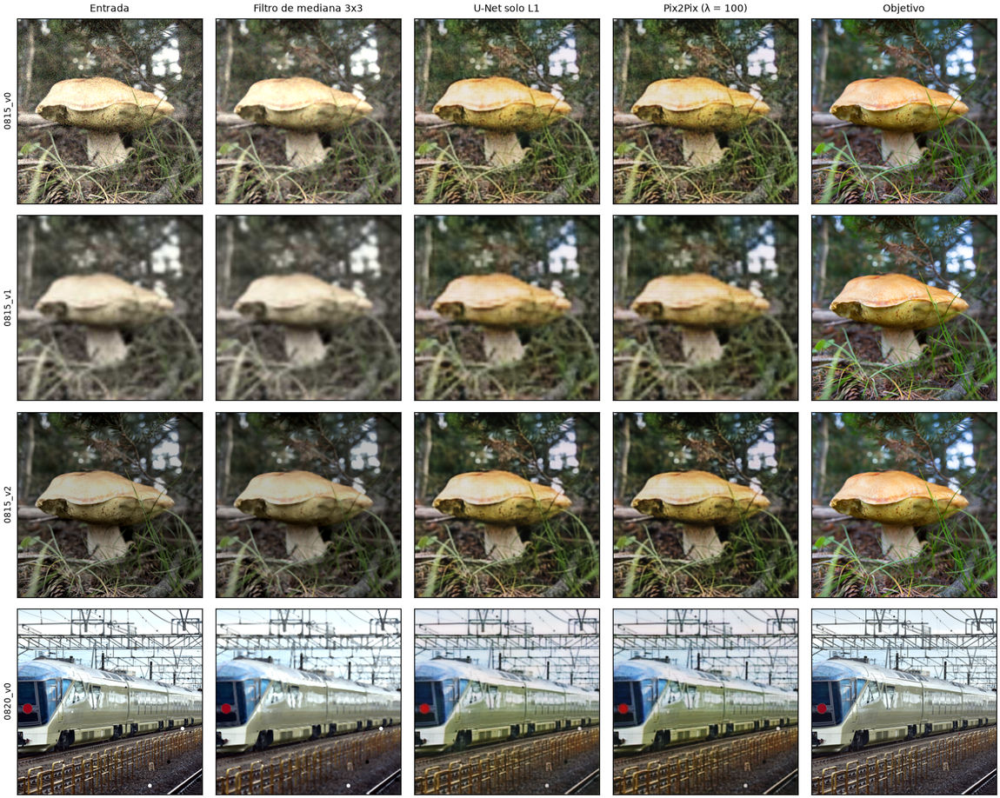
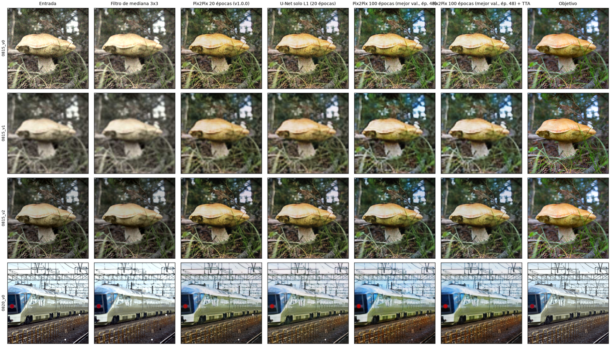
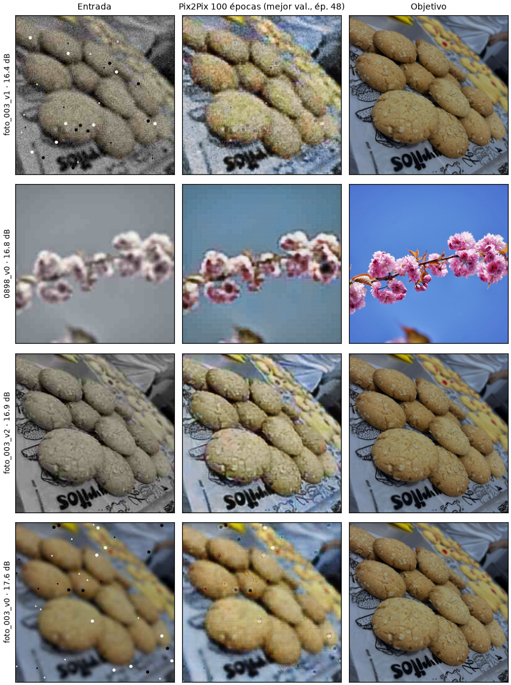

# Resultados

Responsable: Juan Sebastian Castillo Acevedo (`@Juansec01`). Bucle de entrenamiento de Cristian
Muñoz (`@CristianMP355`); la corrida base en Colab la ejecutó Isabela Cabezas (`@Isabela1105`) y
sus artefactos están en su Drive (`pix2pix_outputs/metricas_loss_existente/`).

Regla: cada cifra de este documento sale de un archivo. Si un número no tiene archivo
detrás, no se publica.

> **Modelo vigente (nueva sustentación):** Pix2Pix con objetivo de 100 épocas, elegido por
> validación (época 48), con TTA de 4 volteos: **21.30 dB, SSIM 0.7165, L1 0.0681** en test. Ver la [sección 6](#6-nueva-sustentación-100-épocas-y-selección-por-validación).
> Las secciones 1 a 5 documentan la entrega `v1.0.0` (20 épocas) y no se reescriben.

## 1. Corrida base en Colab (evidencia disponible)

| Dato | Valor | Fuente |
|---|---|---|
| Configuración | `configs/base.yaml` con `epochs: 20` y rutas de Colab | `notebooks/pix2pix_entrenamiento_colab.ipynb` (celda 5) |
| Hardware | Colab con GPU, TensorFlow 2.21.0, mixed precision activa | mismo notebook (celdas 1 y 7) |
| Dataset | 366 / 45 / 45 pares (train / val / test), 256×256 | `docs/dataset_stats.md` y celda 7 del notebook |
| Pérdidas | `src/gan/losses.py` de la rama `feat/discriminator-losses` (BCE + λ·L1, λ = 100); solo difiere de `main` en un `if` equivalente | celdas 2 y 6 del notebook |
| Duración | 522.1 s para 20 épocas | salida de la celda de entrenamiento |
| Registro por época | `docs/resultados/colab_base_20ep_log.csv` | transcrito de la salida impresa por `train.py` |


`python scripts/plot_training_log.py docs/resultados/colab_base_20ep_log.csv docs/img/curvas_entrenamiento.png`

### 1.1 Validación (`metrics.csv` de la corrida, split `val`)

| Época | L1 val ([-1, 1]) ↓ | PSNR val (dB) ↑ | SSIM val ↑ |
|---|---|---|---|
| 0 | 0.1973 | 18.15 | 0.4340 |
| 1 | 0.1745 | 19.19 | 0.4764 |
| 2 | 0.1703 | 19.40 | 0.4841 |
| 3 | 0.1683 | 19.46 | 0.4833 |
| 4 | 0.1581 | 19.71 | 0.4974 |
| 16 (mejor L1) | 0.1443 | — | — |
| 19 (última) | 0.1482 | 20.26 | 0.5077 |
| *Referencia: entrada sin restaurar* | *0.1680* | *19.27* | *0.4606* |

Las filas 0–4 y 19 son las que el notebook mostró completas; para las épocas 5–18 solo quedó
impresa la L1 de validación (ver el CSV transcrito). El `metrics.csv` completo está en el Drive
del equipo (`pix2pix_outputs/metricas_loss_existente/metrics.csv`).

> **Cuidado al comparar.** `train.py` mide en `[-1, 1]`. Su PSNR es igual al de `[0, 1]`, pero
> su L1 es el **doble**: 0.1482 en `[-1, 1]` equivale a ≈ 0.074 en `[0, 1]`. La tabla final del
> test usa `[0, 1]` (`src/gan/metrics.py`).

### 1.2 Lectura de las curvas

- **El generador sí aprende y supera a no hacer nada:** frente a la foto degradada sin
  restaurar (misma convención de `train.py`, `docs/resultados/val_lineas_base_summary.csv`),
  la época 19 mejora +0.99 dB de PSNR (19.27 → 20.26), +0.047 de SSIM (0.461 → 0.508) y −12 % de
  L1 (0.168 → 0.148). En la época 0 el modelo estaba **por debajo** de la entrada (18.15 dB): las
  primeras épocas solo aprenden a no empeorar la foto.
- **La mejora es modesta:** ≈ 1 dB sobre la entrada. Con 20 épocas y D dominando, el margen
  es pequeño; la corrida de 45 épocas de Cristian (sección 3) llega a 20.61 dB.
- **El discriminador domina pronto:** desde la época 2 su pérdida queda por debajo de 0.04 y
  termina en ≈ 0. Significa que distingue casi perfectamente lo real de lo generado; el
  generador avanza sobre todo por el término L1. Es una limitación conocida de Pix2Pix con
  datasets pequeños y la razón de dejar documentadas opciones como *label smoothing*.
- **No hubo early stopping:** la mejor L1 fue en la época 16 y la paciencia es 15 épocas; con
  solo 20 épocas la corrida terminó por límite. El checkpoint guardado es el de la última época
  (19), cuya L1 está a 0.004 de la mejor.

## 2. Tabla final del split de prueba

La tabla se genera con `src/gan/evaluate.py` sobre los 45 pares de `test` y se inserta en el
README y en el informe con `scripts/results_table.py`. No se escribe a mano.

```bash
# Con la carpeta checkpoints/ de la corrida copiada en outputs/base/checkpoints
python -m src.gan.evaluate --config configs/base.yaml --checkpoint outputs/base/checkpoints
python scripts/results_table.py --summary outputs/base/eval/summary.csv \
  --update README.md report/informe.md docs/RESULTADOS.md
cp outputs/base/eval/results_grid.png outputs/base/eval/failures.png docs/img/
```

La sección 5 de `notebooks/pix2pix_colab.ipynb` hace estos pasos en Colab leyendo el
checkpoint desde Drive.

<!-- RESULTADOS:INICIO -->
| Modelo | n | PSNR (dB) ↑ | SSIM ↑ | L1 ↓ |
|---|---|---|---|---|
| Entrada (sin restaurar) | 45 | 20.30 ± 2.68 | 0.6558 ± 0.1789 | 0.0749 ± 0.0279 |
| Filtro de mediana 3x3 | 45 | 20.05 ± 2.26 | 0.6655 ± 0.1076 | 0.0755 ± 0.0264 |
| **U-Net solo L1** | 45 | 20.87 ± 1.98 | 0.7011 ± 0.1102 | 0.0704 ± 0.0215 |
| Pix2Pix (λ = 100) | 45 | 20.67 ± 2.15 | 0.6835 ± 0.1094 | 0.0732 ± 0.0263 |

_Split `test`, métricas en [0, 1] por imagen completa (media ± std). Fuente: `docs/resultados/test/summary.csv`._
<!-- RESULTADOS:FIN -->

### 2.1 Qué pesos se evaluaron

Los checkpoints de las corridas de Colab no quedaron accesibles, así que la tabla usa una corrida
reproducida con `configs/base.yaml` (misma semilla 42, mismo dataset) durante **20 épocas** para
Pix2Pix y 20 para la ablación (`use_gan: false`, λ = 1000), en CPU. Sus curvas de validación
coinciden con la corrida de Isabela: época 0 L1 0.1967 frente a 0.1973; época 19 PSNR 20.25 dB
frente a 20.26 dB.

| Corrida | L1 val ([-1, 1]) | PSNR val (dB) | SSIM val | Registro |
|---|---|---|---|---|
| Pix2Pix, 20 épocas (pesos publicados) | 0.1506 | 20.25 | 0.5146 | `docs/resultados/base_20ep_metrics.csv` |
| U-Net solo L1, 20 épocas (pesos publicados) | 0.1497 | 20.31 | 0.5335 | `docs/resultados/ablacion_20ep_metrics.csv` |


Los pesos del generador de ambas corridas están en el release `v1.0.0`.

### 2.2 Lectura de la tabla

- **Los dos modelos superan a no hacer nada**, pero por poco: Pix2Pix +0.37 dB de PSNR y +0.028 de
  SSIM sobre la entrada; la ablación +0.57 dB y +0.045. La mediana empeora el PSNR (−0.25 dB).
- **La ablación supera a Pix2Pix** en las tres métricas y en 33 de las 45 imágenes. Es lo esperado:
  PSNR, SSIM y L1 premian la fidelidad píxel a píxel que optimiza L1; el término adversarial empuja
  a texturas plausibles que no coinciden con el píxel exacto.
- **El modelo ayuda donde hay más daño.** Pix2Pix mejora la entrada en 28 de 45 imágenes: en las
  que mejora, la entrada tenía 18.9 dB en promedio; en las que empeora, 22.6 dB. Con fotos poco
  dañadas, el modelo cambia color y textura más de lo necesario.
- **La desviación estándar baja** (2.68 → 2.15 dB): el modelo hace más parejo el resultado entre
  fotos.

### 2.3 Por tipo de degradación (PSNR medio en test, dB)

| Degradación | n | Entrada | Mediana 3×3 | Solo L1 | Pix2Pix |
|---|---|---|---|---|---|
| Desvanecido (fade) | 25 | 19.16 | 19.02 | 20.58 | 20.55 |
| Contraste | 19 | 19.47 | 18.97 | 20.90 | 20.43 |
| Ruido | 20 | 19.92 | 20.12 | 20.84 | 20.42 |
| Desenfoque | 25 | 19.96 | 20.03 | 20.62 | 20.40 |
| Baja resolución | 15 | 19.10 | 19.51 | 19.98 | 19.94 |
| JPEG | 26 | 20.09 | 19.99 | 20.45 | 20.52 |
| Polvo | 19 | 20.39 | 19.96 | 20.82 | 20.52 |
| Rayones | 6 | 19.40 | 19.89 | 21.46 | 21.20 |

Un par puede tener varias degradaciones, así que los grupos se solapan. Fuente:
`docs/resultados/test/per_image.csv`. Las mayores ganancias están en **color y contraste**
(+1.4 dB en desvanecido); las menores, en **baja resolución** (+0.8 dB): el modelo no puede
recuperar detalle que no existe. Los rayones tienen solo 6 pares.

### 2.4 Figuras



Primeras cuatro imágenes de test en orden alfabético: el modelo recupera saturación y contraste
(champiñón) y quita parte del polvo, pero no devuelve la nitidez perdida por desenfoque.


Los tres peores casos son las tres variantes de una misma fuente (`0898`, flores sobre cielo
azul): el ruido fuerte sobre una zona lisa deja una textura granulada y artefactos en cuadrícula,
y en `0898_v0` el desvanecido extremo no permite recuperar el azul del cielo.

### 2.5 Limpieza de puntos de polvo (post-entrega)

El generador copia parte de las motas negras y blancas de la entrada. `src/gan/despeckle.py`
las detecta sin entrenar nada: píxeles grises mucho más oscuros o claros que la mediana 7×7,
agrupados en manchas pequeñas (3–40 px), compactas y rodeadas de un tono distinto. Así no toca
cables, líneas ni objetos oscuros grandes. Cada mancha se rellena con la mediana de sus vecinos.
Se aplica **antes** del generador (para que no copie el polvo) y **después** (por si queda alguno).

```bash
python -m src.gan.evaluate --config configs/base.yaml \
    --checkpoint outputs/base/checkpoints --limpieza --out outputs/eval_limpieza
```

| Modelo (test, n = 45) | PSNR (dB) ↑ | SSIM ↑ | L1 ↓ | PSNR fotos con polvo (19) | PSNR sin polvo (26) |
|---|---|---|---|---|---|
| Entrada (sin restaurar) | 20.30 | 0.6558 | 0.0749 | 20.39 | 20.23 |
| Pix2Pix (λ = 100) | 20.67 | 0.6835 | 0.0732 | 20.52 | 20.78 |
| **Pix2Pix + limpieza de puntos** | **20.75** | **0.6859** | **0.0729** | **20.82** | 20.70 |

En las fotos con polvo gana +0.30 dB; en las que no tienen, pierde 0.08 dB por algún falso
positivo en texturas finas. La tabla oficial de la sección 2 (la de la entrega v1.0.0) **no
cambia**: se calcula sin limpieza. La demo la usa por defecto y se puede apagar con la casilla
*Quitar puntos de polvo* (o `--sin-limpieza` en `src.gan.infer` y `scripts/restore_folder.py`).

Limitación honesta: quita la mayoría de las motas, no siempre todas. Las de 1 px se confunden
con ruido y no se tocan; los rayones (líneas) se dejan a propósito para no borrar cables reales.

## 3. Corrida de 45 épocas y ablación de Cristian Muñoz (validación)

Cristian entrenó en Colab (GPU T4, último `main`, `datasetv1.zip`) la base Pix2Pix y la ablación
sin GAN. Cifras **reportadas por él**, pendientes de sumar sus `metrics.csv` al repositorio:

| Corrida | Épocas | PSNR val (dB) | SSIM val |
|---|---|---|---|
| Entrada sin restaurar (referencia) | — | 19.27 | 0.4606 |
| Pix2Pix (GAN + L1, λ = 100) | 45 | 20.61 | 0.5164 |
| U-Net solo L1 (λ = 1000, sin D) | 44 | 20.78 | 0.5397 |

La ablación supera a Pix2Pix en PSNR y SSIM. Es esperable: ambas métricas premian la
fidelidad píxel a píxel, que es justo lo que optimiza L1, mientras el término adversarial
empuja a texturas plausibles que pueden alejarse del píxel exacto. La comparación visual
(`results_grid.png`) es la que muestra si la GAN aporta nitidez.

### 3.1 Implementación de la ablación

`configs/ablation_l1.yaml` + `train.use_gan: false` + `λ = 1000` ya está implementado y probado
(`tests/test_train_integration.py::test_real_ablation_only_trains_generator`). Un primer
intento con el notebook original falló porque el zip del dataset no estaba en la ruta esperada;
la corrida de Cristian de la tabla anterior sí se completó. Para repetirla:
`notebooks/pix2pix_colab.ipynb`, sección 3 (`ENTRENAR_ABLACION = True`).

## 4. Fotos antiguas reales y demo

- Las 12 fotos de `real.zip` se restauran con
  `python scripts/restore_folder.py --checkpoint outputs/base/checkpoints --input data/real`.
  No tienen versión limpia (sin métricas) y su licencia no está verificada, así que la
  comparación solo va en el informe entregado, no en el repositorio. Visualmente: el modelo
  sube contraste y atenúa grietas finas, pero no rellena roturas, manchas ni partes faltantes,
  que no están entre las 8 degradaciones del entrenamiento.
- Demo: `docs/img/app.png` (`python -m app.server --checkpoint outputs/base/checkpoints`).

## 5. Siguiente paso: nitidez

El modelo entregado deja la imagen suave. El experimento de `docs/EXPERIMENTO_NITIDEZ.md`
(100 épocas, pérdida perceptual VGG16, λ_L1 = 50, label smoothing 0.1) ataca esa limitación
sin modificar los resultados de esta página.

## 6. Nueva sustentación: 100 épocas, selección por validación y TTA

### 6.1 Qué se cambió y por qué

La entrega `v1.0.0` entrenó solo 20 épocas (≈ 3 660 iteraciones con lote 2), aunque el config de
diseño prevé 100. Para la nueva sustentación se mantuvieron **los mismos datos, arquitectura e
hiperparámetros**: 456 pares de 256×256 (366 / 45 / 45, a partir de 152 fotos fuente con 3
variantes cada una), λ = 100, Adam 2e-4 constante. Cambiaron tres cosas:

1. **Más épocas** (objetivo 100, sin early stopping).
2. **Selección del modelo por validación.** `train.py` guarda en `best/` el generador de la época
   con menor L1 de validación (PR #53). El test solo se usa para reportar.
3. **TTA (test-time augmentation):** se restaura la foto y sus 3 versiones volteadas, y se
   promedian (`src/gan/infer.py::generate`). Se eligió por validación (+0.05 dB, +0.014 SSIM).

### 6.2 Corridas

| Corrida | Hardware | Épocas | Resultado |
|---|---|---|---|
| Colab #1 | GPU T4 | 100 completas | La **última** época da 20.41 dB / 0.654 en test: peor que la de 20 épocas. |
| Colab #2 | GPU T4 | 70 de 100 | Mejor validación en la época 62 (20.77 dB / 0.701 en test). Se detuvo y su `best/` se perdió porque se llenó el Drive (≈ 700 MB por checkpoint). |
| **Vigente** | CPU | 0–61, retomada desde la de 20 épocas | **Mejor validación en la época 48** (21.13 dB, L1 0.1369 en val). Las 13 épocas siguientes no la superaron; se detuvo en la 61 por tiempo. |

Conclusión de las tres: **en una GAN la última época no es el mejor modelo.** La L1 de
validación oscila de una época a otra (entre 0.137 y 0.155 desde la época 20 en la corrida vigente) porque G y D se persiguen.
Elegir por validación es lo que convierte las épocas extra en mejora real. Curvas de la corrida
vigente (`docs/resultados/pix2pix_100ep_metrics.csv`):


**Reproducibilidad.** Con la misma semilla (42), la corrida de 100 épocas en Colab repitió los
valores de validación de la corrida de 20 épocas de Isabela
(`notebooks/pix2pix_entrenamiento_colab.ipynb`) en las épocas 0–16; por ejemplo, L1 de
validación 0.1973 en la época 0 y 0.1443 en la 16 en ambas. Desde la 17 se separan levemente por
el no-determinismo de las operaciones en GPU.

### 6.3 Tabla final (test, 45 imágenes)

| Modelo | PSNR (dB) ↑ | SSIM ↑ | L1 ↓ |
|---|---|---|---|
| Entrada sin restaurar | 20.30 ± 2.68 | 0.6558 ± 0.1789 | 0.0749 ± 0.0279 |
| Filtro de mediana 3×3 | 20.05 ± 2.26 | 0.6655 ± 0.1076 | 0.0755 ± 0.0264 |
| Pix2Pix 20 épocas (`v1.0.0`) | 20.67 ± 2.15 | 0.6835 ± 0.1094 | 0.0732 ± 0.0263 |
| U-Net solo L1 (20 épocas) | 20.87 ± 1.98 | 0.7011 ± 0.1102 | 0.0704 ± 0.0215 |
| U-Net solo L1 (mejor val., ép. 45) + TTA | 21.21 ± 2.22 | **0.7222 ± 0.1100** | 0.0694 ± 0.0249 |
| Pix2Pix 100 épocas (mejor val., ép. 48) | 21.14 ± 2.08 | 0.7003 ± 0.1064 | 0.0690 ± 0.0220 |
| **Pix2Pix 100 épocas (ép. 48) + TTA** | **21.30 ± 2.15** | 0.7165 ± 0.1077 | **0.0681 ± 0.0236** |

Fuente: `docs/resultados/test_100ep/summary.csv` (salida de `src.gan.evaluate`).

La demo aplica además la limpieza de polvo (§2.5). Con el modelo vigente + TTA, la limpieza da
+0.04 dB y +0.004 de SSIM en validación, y en test 21.23 dB / 0.7175 (−0.07 dB, +0.001 SSIM): un
efecto pequeño en las métricas, pero quita las motas visibles. La tabla reporta el modelo sin ella.

**Comparación pareada** (misma imagen, diferencia por foto; t = media / error estándar):

| Modelo vigente frente a… | ΔPSNR | t | Gana en PSNR | ΔSSIM | Gana en SSIM |
|---|---|---|---|---|---|
| Entrada sin restaurar | +1.00 dB | 2.30 | 31 de 45 | +0.061 | 34 de 45 |
| Pix2Pix 20 épocas (`v1.0.0`) | +0.63 dB | 4.75 | 37 de 45 | +0.033 | **45 de 45** |
| U-Net solo L1 (20 épocas) | +0.43 dB | 3.90 | 32 de 45 | +0.015 | 43 de 45 |
| **U-Net solo L1, mismo protocolo (ép. 45 + TTA)** | +0.09 dB | 1.34 | 21 de 45 | **−0.006** (t = −6.1) | 9 de 45 |

- La ganancia sobre la entrada pasa de **+0.37 dB a +1.00 dB** y de +0.028 a +0.061 de SSIM.
- Frente a la entrega anterior, la mejora es consistente: mejor SSIM en las 45 fotos.
- **Ablación justa (§7.4):** con el mismo protocolo (continuada desde 20 épocas, elegida por
  validación en la época 45 y con TTA), la U-Net solo L1 **empata** en PSNR y L1 y **gana en SSIM**.
  Frente a la U-Net de 20 épocas, Pix2Pix sí gana en todo, pero esa comparación no es justa.

### 6.4 Análisis de errores del modelo vigente

`docs/resultados/test_100ep/analisis_errores.md`. Correlación entre el PSNR de la entrada y la
ganancia: **−0.71**.

| PSNR de la entrada | n | Ganancia `v1.0.0` | Ganancia vigente | Mejora en (vigente) |
|---|---|---|---|---|
| < 18 dB (muy dañada) | 6 | +2.67 | **+3.61** | 6 de 6 |
| 18–20 dB | 17 | +1.47 | **+2.25** | 15 de 17 |
| 20–22 dB | 11 | +0.29 | **+1.15** | 9 de 11 |
| ≥ 22 dB (poco dañada) | 11 | −2.48 | −2.49 | 1 de 11 |

| Degradación | n | Ganancia `v1.0.0` | Ganancia vigente | Mejora en (vigente) |
|---|---|---|---|---|
| Rayones | 6 | +1.80 | +2.83 | 6 de 6 |
| Contraste | 19 | +0.96 | +1.97 | 15 de 19 |
| Desvanecido | 25 | +1.39 | +1.95 | 21 de 25 |
| Desenfoque | 25 | +0.43 | +1.23 | 19 de 25 |
| Ruido | 20 | +0.50 | +1.20 | 14 de 20 |
| Baja resolución | 15 | +0.84 | +1.18 | 11 de 15 |
| JPEG | 26 | +0.43 | +0.86 | 18 de 26 |
| Polvo | 19 | +0.13 | +0.76 | 13 de 19 |

Lectura para la sustentación:

1. **Mejora en todos los tipos de daño**, y más en los globales (rayones, contraste, color) que en
   los finos (JPEG, polvo, baja resolución): una U-Net a 256×256 con pérdida L1 promedia el
   detalle que no puede inferir.
2. **El modo de falla persiste: sobre-corrige fotos poco dañadas.** Con entradas de ≥ 22 dB
   empeora 10 de 11 (−2.5 dB), aunque el SSIM ya no baja (+0.007). El entrenamiento solo vio
   pares dañados, así que nunca aprendió a «no hacer nada». Mejora propuesta: incluir pares
   limpio→limpio (identidad) en el entrenamiento.
3. **El discriminador gana muy pronto** (pérdida de D cerca de 0 en muchas épocas, ver curvas):
   su señal es débil. Por eso las métricas de Pix2Pix y de la U-Net solo L1 son cercanas.
4. **La salida sigue siendo suave.** La máscara de enfoque (casilla *Realzar nitidez* de la demo,
   `--nitidez` en `src.gan.infer`) hace la foto más definida a la vista, pero en validación y
   prueba **baja** el PSNR y el SSIM con cualquier intensidad probada (con 0.3: −0.13 dB en validación y −0.06 dB en prueba), porque
   también realza el ruido. Por eso no está en la tabla y viene apagada.





### 6.5 Pesos y reproducción

- Pesos del modelo vigente (solo generador, ≈ 210 MB): [`pix2pix_100ep_mejor.zip`](https://github.com/Isabela1105/Trabajo-Final-de-Redes/releases/download/v1.1.0/pix2pix_100ep_mejor.zip) del release `v1.1.0`.
  Se descomprime en la raíz y queda `outputs/pix2pix_100ep_mejor/best/`.
- Evaluar: comando de `docs/resultados/test_100ep/README.md`.
- Entrenar en Colab: `max_to_keep: 1` y al menos 3 GB libres en Drive; el mejor modelo queda en
  `<salida>/best/`.

## 7. Experimentos posteriores (24 nov): qué se probó y por qué no cambió el modelo

Regla: el modelo o la demo solo cambian si la mejora es **evidente en validación** y se confirma
en prueba. El test no se usa para decidir.

### 7.1 Pares sin daño (identidad): resultado negativo

**Hipótesis.** El modelo sobre-corrige las fotos poco dañadas porque nunca vio una foto limpia.
**Prueba.** Se agregaron 55 pares limpio → limpio (15 % de los pares; 1 por foto fuente, elegidas
al azar con semilla 42) al entrenamiento y se continuó desde la época 48 del modelo vigente.

| Épocas 49–57 | L1 val | PSNR val |
|---|---|---|
| Mejor época (49) | 0.1384 | 21.01 |
| Peor época (57) | 0.1447 | 20.75 |
| Modelo vigente (48) | **0.1369** | **21.13** |

Ninguna época superó al modelo vigente en validación. En la época 57, con TTA, quedó peor en todo:
validación 20.80 dB (vigente 21.20), prueba 20.87 dB (vigente 21.30) y **también en las fotos poco
dañadas**, que era el objetivo (prueba ≥ 22 dB: 21.10 frente a 21.71). Se detuvo en la 57.
Lectura: con λ = 100 y un discriminador que domina, 15 % de pares identidad no basta para
enseñar «no tocar»; probablemente necesita entrenarse desde el inicio o una pérdida específica.

### 7.2 Mezcla salida/entrada: no adoptada

`mezcla·salida + (1 − mezcla)·entrada` (`--mezcla` en `src.gan.evaluate` / `predict`).

| Mezcla | PSNR val | SSIM val | L1 val | Mejora sobre 1.0 (val) | PSNR test | SSIM test |
|---|---|---|---|---|---|---|
| 1.0 (vigente) | 21.20 | **0.6593** | 0.0680 | — | 21.30 | 0.7165 |
| 0.9 | 21.28 | 0.6586 | 0.0672 | 25 de 45 | 21.48 | 0.7191 |
| 0.8 | **21.29** | 0.6550 | **0.0670** | 21 de 45 | 21.60 | 0.7183 |

En validación la ganancia es pequeña (+0.08 a +0.10 dB), baja el SSIM y mejora en la mitad de las
fotos o menos: **no es evidente**, así que no se adopta aunque en prueba saldría mejor. Queda como
opción apagada.

### 7.3 Corrección sobre `label_smoothing`

`src/gan/losses.py` no acepta `label_smoothing`, pero no es un error silencioso: `train.py` avisa
cuando se pide y `src/gan/losses_nitidez.py` sí lo implementa. No se modificó el módulo original.

### 7.4 Ablación con el mismo protocolo: la GAN no mejora las métricas píxel a píxel

Para que la comparación sea justa, la U-Net solo L1 (sin discriminador, λ = 1000) se continuó
desde sus 20 épocas hasta la 61 con selección por L1 de validación (igual que Pix2Pix). Su mejor
época fue la **45** (L1 val 0.1378, PSNR val 21.04; Pix2Pix: 0.1369 y 21.13). Curvas:
`docs/resultados/ablacion_100ep_metrics.csv`. Test con TTA (`summary_ablacion.csv`,
`per_image_ablacion.csv`):

| Test, 45 fotos, ambos con TTA | PSNR | SSIM | L1 | Ganancia sobre la entrada |
|---|---|---|---|---|
| U-Net solo L1 (ép. 45) | 21.21 | **0.7222** | 0.0694 | +0.91 dB |
| Pix2Pix (ép. 48) | **21.30** | 0.7165 | **0.0681** | +1.00 dB |
| Diferencia pareada (Pix2Pix − U-Net) | +0.09 (t = 1.34) | −0.006 (t = −6.09) | −0.0013 (t = −1.75) | |

- **PSNR y L1: empate estadístico** (|t| < 2; Pix2Pix es mejor en 21 de 45 fotos).
- **SSIM: gana la U-Net** en 36 de 45 fotos. Con el mismo entrenamiento, la pérdida adversarial no
  mejora las métricas de fidelidad: es lo que reporta el artículo de Pix2Pix (Isola et al., 2017),
  donde la GAN busca realismo perceptual y nitidez, no menor error por píxel.
- Las dos sobre-corrigen las fotos poco dañadas (≥ 22 dB: −2.5 y −2.6 dB): el problema es de los
  datos de entrenamiento, no de la GAN.
- **Decisión:** el modelo vigente se mantiene. En validación, el criterio de selección, Pix2Pix
  queda marginalmente arriba (L1 0.1369 frente a 0.1378), y no hay una mejora evidente que
  justifique cambiar.
- Conclusión anterior corregida: con 20 épocas, Pix2Pix parecía ganarle a la U-Net solo porque la
  U-Net tenía menos entrenamiento.

