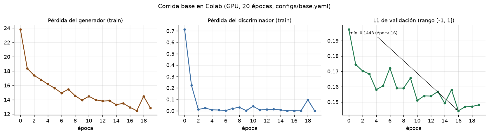
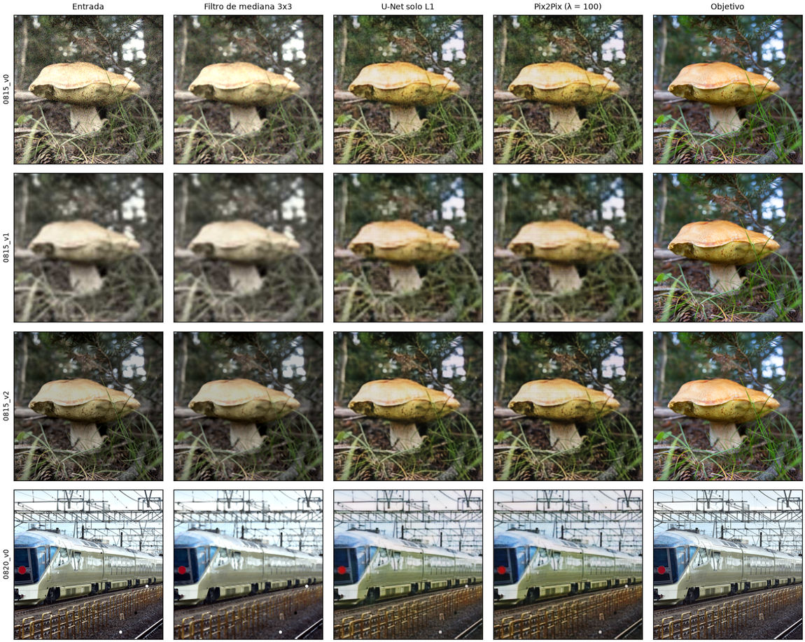
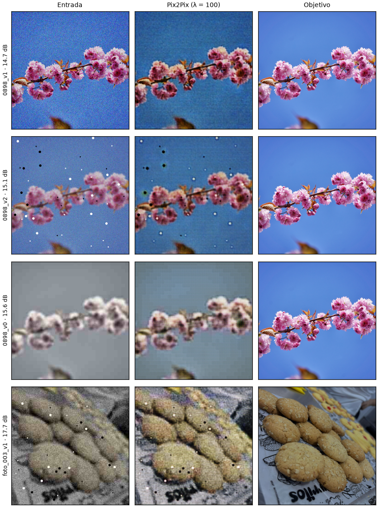
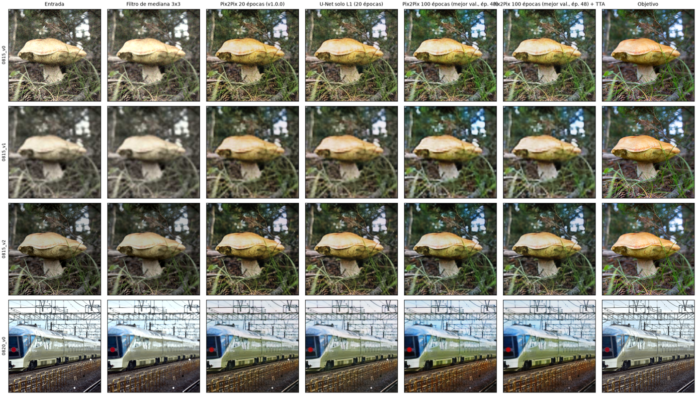
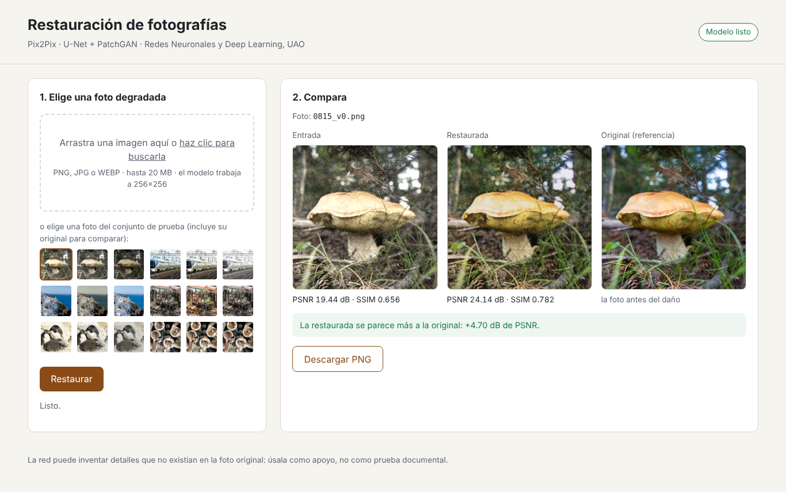

**Repositorio:** <https://github.com/Isabela1105/Trabajo-Final-de-Redes>
**Tag de resultados:** `v1.0.0` (20 épocas); modelo vigente: 100 épocas, época 48 + TTA (§6.7)

## Resumen

Este trabajo entrena una GAN condicional Pix2Pix [@isola2017pix2pix] para restaurar
fotografías con ruido, desenfoque, compresión JPEG, baja resolución, desvanecido de color,
rayones y polvo. Se construyó un dataset propio de 152 fotos fuente (DIV2K, Pexels y fotos de
los integrantes) del que se generaron 456 pares degradado/limpio de 256×256 con un pipeline de
degradaciones reproducible y un split 80/10/10 **por foto fuente** para evitar fuga de datos.
El generador es una U-Net de 8 niveles (54.5 M de parámetros) y el discriminador un PatchGAN
de 70×70 (2.8 M). Una corrida de 20 épocas en Colab (GPU, 522 s) redujo la L1 de validación de
0.197 a 0.148 y llevó el PSNR de validación a 20.26 dB, ≈ 1 dB por encima de la foto sin
restaurar (19.27 dB); una corrida posterior de 45 épocas alcanzó 20.61 dB.
El discriminador dominó desde la segunda época, de modo que el aprendizaje del generador
estuvo guiado sobre todo por el término L1. La evaluación final sobre el split de prueba se
genera con `src/gan/evaluate.py` contra dos líneas base (entrada sin restaurar y filtro de
mediana). El proyecto incluye una demo web propia (FastAPI + HTML/CSS/JS) que restaura una
imagen en local sin internet.

## 1. Introducción

### 1.1 Motivación

Muchas fotografías familiares e históricas solo existen como copias físicas deterioradas o
escaneos de baja calidad. Restaurarlas a mano exige tiempo y experiencia; un modelo que
aprenda el mapeo *foto dañada → foto limpia* puede servir como primer paso automático.

### 1.2 Problema

Dada una imagen RGB con una combinación desconocida de degradaciones, producir una imagen del
mismo tamaño que se parezca lo más posible a la original sin dañar. Es un problema de
*image-to-image translation* con pares alineados, que es exactamente el caso para el que se
diseñó Pix2Pix.

### 1.3 Objetivos

**General:** entrenar una GAN condicional para restaurar fotografías degradadas.

**Específicos:**

1. Construir un dataset propio de pares degradado/limpio.
2. Implementar Pix2Pix (U-Net + PatchGAN) en TensorFlow/Keras.
3. Entrenar y validar con PSNR, SSIM y L1.
4. Desplegar una demo de restauración.

### 1.4 Aportes

- Pipeline reproducible de degradaciones con manifiesto (semilla por par).
- Implementación completa de Pix2Pix con entrenamiento reanudable en Colab.
- Evaluación por imagen con líneas base y desglose por tipo de degradación.
- Demo web local y repositorio con CI (lint, pruebas y *smoke training*).

## 2. Marco teórico

### 2.1 Redes generativas adversariales

Una GAN [@goodfellow2014gan] entrena dos redes en competencia: un generador $G$ que produce
muestras y un discriminador $D$ que intenta distinguirlas de las reales. El objetivo es el
juego minimax
$\min_G \max_D \; \mathbb{E}_y[\log D(y)] + \mathbb{E}_z[\log(1 - D(G(z)))]$.

### 2.2 Pix2Pix

Pix2Pix [@isola2017pix2pix] condiciona ambas redes a la imagen de entrada $x$: $G$ recibe $x$
y $D$ juzga pares $(x, y)$. La pérdida del generador suma el término adversarial y una L1 con
la imagen objetivo:
$\mathcal{L}_G = \mathrm{BCE}(D(x, G(x)), 1) + \lambda \, \lVert y - G(x) \rVert_1$, con
$\lambda = 100$. La L1 obliga a la fidelidad de baja frecuencia; el término adversarial empuja
a texturas realistas que la L1 sola tiende a borrar.

### 2.3 U-Net

La U-Net [@ronneberger2015unet] es un encoder-decoder con *skip connections* que concatenan
cada nivel del encoder con el nivel del decoder de igual resolución. Así los detalles finos no
tienen que atravesar el cuello de botella de 1×1.

### 2.4 PatchGAN

En lugar de un único veredicto por imagen, el discriminador produce un mapa de 30×30 logits;
cada celda juzga un parche de 70×70 píxeles. Se concentra en la estructura local (textura,
bordes), tiene menos parámetros y funciona con cualquier tamaño de entrada.

### 2.5 Métricas

- **PSNR** $= 10 \log_{10}(1/\mathrm{MSE})$ en $[0,1]$: error cuadrático en decibelios; no
  siempre coincide con la percepción.
- **SSIM** [@wang2004ssim]: compara luminancia, contraste y estructura en ventanas locales.
- **L1**: error absoluto medio; misma familia que la pérdida de entrenamiento.
- **FID** [@heusel2017fid] (opcional): distancia entre distribuciones de características de
  InceptionV3; con 45 imágenes de prueba su varianza es alta.

## 3. Dataset

### 3.1 Recolección

152 fotos fuente: 100 de la validación HR de DIV2K [@agustsson2017div2k] (uso académico), 30 de Pexels (Pexels
License) y 22 tomadas por Isabella Ortiz con su celular. Tamaño original entre 721 y 7953 px
de ancho (media 2392). Autor, licencia y enlace de cada foto en `data/sources.csv`.

Aparte hay 12 fotos antiguas reales sin pareja limpia (`data/real_sources.csv`) que solo se
usan para inspección visual; no entran en entrenamiento ni en métricas.

### 3.2 Degradaciones sintéticas

Cada par recibe un subconjunto aleatorio de ocho operaciones con probabilidades fijas:
baja resolución (40 %), desenfoque (70 %), ruido (60 %), desvanecido (50 %), contraste (30 %),
rayones (40 %), polvo (40 %) y JPEG (50 %). Si el sorteo no elige ninguna se fuerza una. La
semilla de cada par y la lista de degradaciones quedan en `data/manifest.csv`.

### 3.3 Splits y prevención de fuga

Split 80/10/10 **por foto fuente**: las 3 variantes de una foto caen siempre en el mismo
split. Resultado: 122/15/15 fuentes y 366/45/45 pares. `scripts/check_dataset.py` falla si una
fuente aparece en más de un split.

### 3.4 Estadísticas

| Degradación | train | val | test | % de pares |
|---|---|---|---|---|
| blur | 266 | 31 | 25 | 70.6 |
| noise | 216 | 27 | 20 | 57.7 |
| jpeg | 178 | 25 | 26 | 50.2 |
| fade | 173 | 20 | 25 | 47.8 |
| dust | 151 | 20 | 19 | 41.7 |
| downscale | 149 | 20 | 15 | 40.4 |
| scratches | 139 | 22 | 6 | 36.6 |
| contrast | 105 | 21 | 19 | 31.8 |

Fuente: `docs/dataset_stats.md` (`scripts/dataset_report.py`). El test tiene pocos pares con
rayones (6), así que las conclusiones sobre ese tipo son débiles.

### 3.5 Ética, consentimiento y licencias

Las fotos de entrenamiento y prueba tienen licencia de uso académico (DIV2K), Pexels License o
son propias. Las 12 fotos antiguas del conjunto real vienen de Pinterest con autor desconocido
y licencia sin verificar: por eso no se suben a git ni se publican, y deben reemplazarse por
fotos de dominio público si el repositorio se hace público. Ninguna imagen se versiona en git.

### 3.6 Limitaciones

Las degradaciones son sintéticas: un daño real (humedad, partes faltantes, pliegues) puede no
parecerse a ninguna de las ocho operaciones. Con 152 fuentes la diversidad de escenas es
limitada.

## 4. Arquitectura

### 4.1 Contratos de tensores

| Componente | Entrada | Salida |
|---|---|---|
| Dataset | rutas PNG | `(input, target)` float32 `(256,256,3)` en $[-1,1]$ |
| Generador | `(B,256,256,3)` | `(B,256,256,3)` en $[-1,1]$ (tanh) |
| Discriminador | `[(B,256,256,3), (B,256,256,3)]` | `(B,30,30,1)` logits |

### 4.2 Generador U-Net

Ocho bloques encoder (Conv 4×4, stride 2, LeakyReLU 0.2; InstanceNorm salvo el primero y el
cuello de botella de 1×1) con filtros 64-128-256-512-512-512-512-512, y ocho bloques decoder
(ConvTranspose 4×4, stride 2, ReLU, InstanceNorm; dropout 0.5 en los tres primeros) que
concatenan la salida del encoder de igual tamaño. Una convolución 3×3 con tanh produce los 3
canales. Total: 54 541 315 parámetros. Tabla capa por capa en `docs/ARQUITECTURA.md` §2.

### 4.3 Discriminador PatchGAN

Concatena entrada y candidata (6 canales) y aplica Conv 64-128-256 (stride 2) y 512 (stride 1)
con BatchNorm y LeakyReLU, más una convolución final a 1 canal. Salida 30×30×1 con campo
receptivo de 70×70. Total: 2 770 497 parámetros.

### 4.4 Función de pérdida

$$\mathcal{L}_D = \tfrac{1}{2}\left[\mathrm{BCE}(D(x,y),1) + \mathrm{BCE}(D(x,G(x)),0)\right]$$
$$\mathcal{L}_G = \mathrm{BCE}(D(x,G(x)),1) + 100 \cdot \mathrm{L1}(G(x), y)$$

BCE con logits (estable numéricamente) promediada sobre los 30×30 parches. El factor 1/2 hace
que D aprenda más lento que G.

### 4.5 Hiperparámetros

| Parámetro | Valor |
|---|---|
| Optimizadores | Adam, lr $2\times10^{-4}$, $\beta_1 = 0.5$, $\beta_2 = 0.999$ (uno por red) |
| Batch | 2 |
| $\lambda_{L1}$ | 100 |
| Recorte de gradiente | norma 1.0 |
| Precisión mixta | float16 en GPU (pérdidas en float32) |
| Early stopping | L1 de validación, paciencia 15 |
| Semilla | 42 |

## 5. Entrenamiento

### 5.1 Hardware y entorno

Google Colab con GPU, TensorFlow 2.21.0. El código de `src/` se clona del repositorio; el
dataset se descomprime desde Drive (`notebooks/pix2pix_entrenamiento_colab.ipynb`).

### 5.2 Configuración

`configs/base.yaml` con `epochs: 20` para la corrida reportada (el valor congelado del YAML es
100 con early stopping).

### 5.3 Checkpoints y reanudación

Cada época se guardan G, D, ambos optimizadores, la época, la semilla y el estado del early
stopping, junto con `config.yaml` y `metadata.json` (hash del YAML). `--resume` solo acepta un
checkpoint completo y con el mismo YAML, lo que evita reanudar con hiperparámetros distintos
tras una desconexión de Colab.

### 5.4 Estabilidad

En cada paso se actualiza primero D y después G con un D ya actualizado. Las pérdidas se
calculan en float32 aunque el modelo use float16, y los gradientes se recortan a norma 1.

### 5.5 Curvas de pérdida



La pérdida del generador bajó de 23.8 a 12.8 y la L1 de validación de 0.197 a 0.148
(mínimo 0.144 en la época 16). La pérdida del discriminador cayó por debajo de 0.04 desde la
época 2: D distingue casi perfectamente lo real de lo generado y la señal adversarial aporta
poco. La corrida terminó por límite de épocas, no por early stopping.

| Época | L1 val ([-1,1]) | PSNR val (dB) | SSIM val |
|---|---|---|---|
| 0 | 0.1973 | 18.15 | 0.4340 |
| 4 | 0.1581 | 19.71 | 0.4974 |
| 19 | 0.1482 | 20.26 | 0.5077 |
| Entrada sin restaurar | 0.1680 | 19.27 | 0.4606 |

## 6. Experimentos y resultados

### 6.1 Protocolo

Evaluación sobre las 45 imágenes del split `test`, nunca usadas en entrenamiento ni para
elegir el checkpoint. Las imágenes se llevan de $[-1,1]$ a $[0,1]$ antes de medir y se reporta
media ± desviación estándar por imagen completa. Las figuras usan las 4 primeras imágenes en
orden alfabético y las 4 de menor PSNR, sin selección manual.

### 6.2 Baselines

1. **Entrada sin restaurar:** la foto degradada tal cual.
2. **Filtro de mediana 3×3:** restauración clásica sin aprendizaje.
3. **U-Net solo L1:** mismo generador sin discriminador, $\lambda = 1000$
   (`configs/ablation_l1.yaml`). Entrenada por Cristian Muñoz durante 44 épocas en Colab.
4. **Pix2Pix ($\lambda = 100$):** modelo principal.

### 6.3 Resultados cuantitativos

<!-- RESULTADOS:INICIO -->
| Modelo | n | PSNR (dB) ↑ | SSIM ↑ | L1 ↓ |
|---|---|---|---|---|
| Entrada (sin restaurar) | 45 | 20.30 ± 2.68 | 0.6558 ± 0.1789 | 0.0749 ± 0.0279 |
| Filtro de mediana 3x3 | 45 | 20.05 ± 2.26 | 0.6655 ± 0.1076 | 0.0755 ± 0.0264 |
| Pix2Pix 20 épocas (v1.0.0) | 45 | 20.67 ± 2.15 | 0.6835 ± 0.1094 | 0.0732 ± 0.0263 |
| U-Net solo L1 (20 épocas) | 45 | 20.87 ± 1.98 | 0.7011 ± 0.1102 | 0.0704 ± 0.0215 |
| U-Net solo L1 (mejor val., ép. 45) + TTA | 45 | 21.21 ± 2.22 | 0.7222 ± 0.1100 | 0.0694 ± 0.0249 |
| Pix2Pix 100 épocas (mejor val., ép. 48) | 45 | 21.14 ± 2.08 | 0.7003 ± 0.1064 | 0.0690 ± 0.0220 |
| **Pix2Pix 100 épocas (mejor val., ép. 48) + TTA** | 45 | 21.30 ± 2.15 | 0.7165 ± 0.1077 | 0.0681 ± 0.0236 |

_Split `test`, métricas en [0, 1] por imagen completa (media ± std). Fuente: `docs/resultados/test_100ep/summary.csv`._
<!-- RESULTADOS:FIN -->

### 6.4 Resultados cualitativos



### 6.5 Galería de fallos



### 6.6 Discusión de resultados

Los pesos evaluados son de una corrida reproducida con `configs/base.yaml` (misma semilla, 20
épocas para cada modelo), cuyas curvas de validación coinciden con las de la corrida de Colab.

En el test, Pix2Pix supera a la foto sin restaurar por 0.37 dB de PSNR y 0.028 de SSIM, y la
ablación sin GAN por 0.57 dB y 0.045; el filtro de mediana empeora el PSNR. La ablación gana a
Pix2Pix en las tres métricas y en 33 de las 45 imágenes: PSNR, SSIM y L1 premian la fidelidad
píxel a píxel que optimiza L1, mientras el término adversarial empuja a texturas plausibles que
no coinciden con el píxel exacto. Además, el discriminador dominó desde la segunda época, así que
su señal aportó poco en 20 épocas.

El modelo ayuda donde hay más daño: en las 28 imágenes que mejora, la entrada tenía 18.9 dB en
promedio; en las que empeora, 22.6 dB. Por tipo de degradación, las mayores ganancias están en
desvanecido (+1.4 dB) y contraste (+1.0 dB), y las menores en baja resolución (+0.8 dB): el modelo
recupera color, pero no detalle que no existe. Los tres peores casos son las variantes de una
misma foto (flores sobre cielo azul), donde el ruido sobre una zona lisa deja textura granulada.

En las 12 fotografías antiguas reales, el modelo sube el contraste y atenúa grietas finas, pero no
rellena roturas, manchas ni partes faltantes, que no están entre las degradaciones de entrenamiento.


### 6.7 Nueva sustentación: 100 épocas, selección por validación y TTA

Se volvió a entrenar Pix2Pix con los mismos datos, arquitectura e hiperparámetros, con un objetivo
de 100 épocas y sin parada temprana. Una corrida en Colab (GPU T4) completó las 100 épocas, pero su
última época dio 20.41 dB y 0.654 de SSIM en prueba, por debajo del modelo de 20 épocas. En una GAN
la calidad no sube de forma monótona: la L1 de validación oscila de una época a otra porque el
generador y el discriminador se persiguen. Por eso el entrenamiento guarda ahora aparte el
generador con menor L1 de validación (`best/`), y el conjunto de prueba solo se usa para reportar.

El modelo vigente continúa la corrida de 20 épocas; su mejor validación fue en la época 48 (21.13 dB
y 0.554 de SSIM en validación) y las 13 épocas siguientes no la superaron. A la inferencia se añadió
TTA: se restaura la foto y sus tres versiones volteadas y se promedian las salidas, lo que reduce el
ruido y los artefactos de cuadrícula. El TTA se eligió por su mejora en validación.

| Modelo (prueba, 45 imágenes) | PSNR (dB) | SSIM | L1 |
|---|---|---|---|
| Entrada sin restaurar | 20.30 | 0.6558 | 0.0749 |
| Pix2Pix 20 épocas (entrega anterior) | 20.67 | 0.6835 | 0.0732 |
| U-Net solo L1 (20 épocas) | 20.87 | 0.7011 | 0.0704 |
| U-Net solo L1, mismo protocolo (ép. 45 + TTA) | 21.21 | **0.7222** | 0.0694 |
| Pix2Pix 100 épocas, última época (Colab) | 20.41 | 0.6540 | 0.0759 |
| Pix2Pix, mejor validación (época 48) | 21.14 | 0.7003 | 0.0690 |
| **Pix2Pix, época 48 + TTA (vigente)** | **21.30** | 0.7165 | **0.0681** |

Frente a la foto dañada, el modelo vigente gana 1.00 dB y 0.061 de SSIM; la entrega anterior ganaba
0.37 dB y 0.028. En comparación pareada con la entrega anterior mejora 0.63 dB de PSNR en promedio
(t = 4.75) y obtiene mejor SSIM en las 45 imágenes. Para una comparación justa, la U-Net solo L1 se
entrenó con el mismo protocolo (selección por validación en la época 45 y TTA): obtiene 21.21 dB,
0.7222 de SSIM y 0.0694 de L1. Las diferencias en PSNR y L1 no son significativas (t = 1.34 y
−1.75), y la U-Net gana en SSIM (t = −6.09). Con el mismo entrenamiento, la pérdida adversarial no
mejora las métricas de fidelidad, como ya reportan Isola et al.; su aporte es perceptual. Se
mantuvo Pix2Pix porque queda marginalmente mejor en validación (L1 0.1369 frente a 0.1378).

Se probaron además tres cambios que no se adoptaron porque no mejoraron la validación de forma
evidente: agregar pares sin daño al entrenamiento (peor en validación y en prueba, incluso en las
fotos poco dañadas), mezclar la salida con la entrada (+0.1 dB en validación, pero con menor SSIM
y mejora en menos de la mitad de las fotos) y ampliar el entrenamiento de 366 a 1 220 pares con el
mismo proceso de daños (20.48 dB en validación y 20.41 dB en prueba, ambos por debajo del modelo
vigente). Con esta receta el modelo llegó a su mejor punto en la época 48; mejorarlo requiere
cambiar la receta, por ejemplo reducir gradualmente la tasa de aprendizaje como en el artículo
original, y no solo entrenar más o con más pares.

El análisis de errores muestra una correlación de −0.71 entre el PSNR de la entrada y la ganancia.
Con entradas de menos de 18 dB el modelo gana 3.6 dB, y entre 18 y 22 dB, de 1.2 a 2.3 dB. Con
entradas de 22 dB o más empeora 10 de 11 imágenes (−2.5 dB): el entrenamiento solo incluyó pares
dañados, así que nunca aprendió a dejar casi intacta una foto limpia. Por tipo de daño, la mejora es
mayor en rayones (+2.8 dB), contraste (+2.0 dB) y desvanecido (+2.0 dB), y menor en JPEG (+0.9 dB)
y polvo (+0.8 dB). La salida sigue siendo suave. Una máscara de enfoque la hace más definida a la
vista, pero baja el PSNR y el SSIM con cualquier intensidad probada, por lo que solo se ofrece como
opción en la demo.



## 7. Aplicación y demo

### 7.1 Cómo ejecutar

```bash
pip install -r requirements.txt
python -m app.server --checkpoint outputs/pix2pix_100ep_mejor/best
# abrir http://127.0.0.1:8000
```

El navegador envía la imagen a `POST /api/restore`; el servidor corrige la orientación EXIF,
compone la transparencia sobre blanco, reduce fotos de más de 4096 px, rellena por reflexión
hasta un cuadrado, normaliza a $[-1,1]$, ejecuta el generador y devuelve un PNG del tamaño de
la entrada. Gradio (`app/gradio_app.py`) es el respaldo. Detalles en `docs/DEMO.md`.

### 7.2 Capturas



### 7.3 Limitaciones de uso

El modelo trabaja a 256×256: en fotos grandes la salida es más suave que la original. No sirve
como prueba documental porque puede inventar detalles.

## 8. Discusión

### 8.1 Limitaciones

Dataset pequeño (152 fuentes), degradaciones sintéticas, resolución de 256×256, una sola
corrida de 20 épocas y desequilibrio entre D y G.

### 8.2 Riesgo de alucinación

Una GAN completa lo que no ve con lo que es plausible según el entrenamiento. En rostros,
texto o zonas muy dañadas puede producir detalles convincentes pero falsos.

### 8.3 Consideraciones éticas

Las fotos restauradas deben marcarse como tales. El conjunto real de licencia sin verificar se
mantiene privado dentro del equipo (sección 3.5).

### 8.4 Trabajo futuro

- Entrenar las 100 épocas del YAML y la ablación sin GAN.
- Equilibrar D y G (*label smoothing*, menor lr de D o LSGAN).
- Pares reales escaneados para validar fuera de las degradaciones sintéticas.
- Mayor resolución por parches.

## 9. Conclusiones

1. Se construyó un dataset propio y reproducible de 456 pares sin fuga entre splits.
2. Se implementó Pix2Pix completo en TensorFlow/Keras con pruebas automáticas de contratos.
3. Con 20 épocas, Pix2Pix superaba a la foto sin restaurar solo por 0.37 dB y la ablación sin GAN
   le ganaba. Entrenando hasta 100 épocas y **eligiendo el modelo por validación** (época 48), más
   TTA, llega a 21.30 dB, 0.7165 de SSIM y 0.0681 de L1: +1.00 dB sobre la entrada y mejor SSIM que
   la entrega anterior en las 45 imágenes. Con el mismo protocolo, la U-Net solo L1 empata en PSNR
   y L1 y gana en SSIM: la GAN no mejora la fidelidad por píxel.
4. La última época de una GAN no es el mejor modelo: la de 100 épocas quedó por debajo de la de 20.
   La selección por validación es lo que convierte el entrenamiento extra en mejora.
5. El modelo corrige sobre todo color, contraste y rayones; sobre-corrige fotos poco dañadas y no
   recupera la nitidez perdida. Los siguientes pasos son pares limpio→limpio en el entrenamiento,
   un discriminador menos dominante y pares reales escaneados.
6. La demo web restaura fotos de cualquier tamaño y formato en local, con limpieza de polvo, TTA
   y comparación contra la original con PSNR y SSIM.

## 10. Referencias

::: {#refs}
:::

## Anexo A — Participación

Resumen del historial de GitHub; detalle en `docs/PARTICIPACION.md`.

| Integrante | Rol asignado | Aporte verificable en `main` |
|---|---|---|
| Isabella Ortiz | Datos | 6 PRs: dataset completo y cargador `tf.data` |
| Juan Pablo Dávila | Generador | sin commits a la fecha |
| Jeremy Caicedo | Discriminador y pérdidas | 2 PRs: generador U-Net, PatchGAN y pérdidas |
| Cristian Muñoz | Entrenamiento | 5 PRs: bucle, checkpoints, métricas, ablación |
| Juan Sebastian Castillo | Evaluación y demo | repositorio inicial + PRs de evaluación, inferencia, demo y cierre |
| Isabela Cabezas | CI/CD e informe | 1 PR; dueña del repositorio y del release |

## Anexo B — Estructura del repositorio

Ver la sección 10 del `README.md`.

## Anexo C — Instrucciones de reproducción

```bash
pip install -r requirements-dev.txt
python scripts/build_dataset.py --raw data/raw --out data/processed --variants 3 --seed 42
python scripts/check_dataset.py --root data/processed --manifest data/manifest.csv
python -m src.gan.train --config configs/base.yaml
python -m src.gan.evaluate --config configs/base.yaml --checkpoint outputs/base/checkpoints
python scripts/results_table.py --summary outputs/base/eval/summary.csv --update README.md report/informe.md
python -m app.server --checkpoint outputs/base/checkpoints
```
